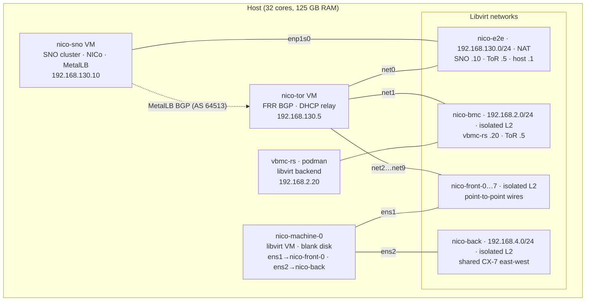
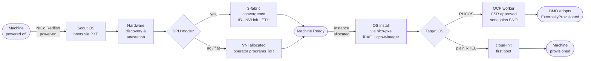

<!--
SPDX-FileCopyrightText: Copyright (c) 2026 Red Hat, Inc. All rights reserved.
SPDX-License-Identifier: Apache-2.0
-->

# End-to-End Test: Libvirt (NICo + vbmc-rs + Metal3 on SNO)

> **Libvirt-based e2e:** SNO management cluster and managed machines are all
> libvirt VMs on a single bare-metal host. vbmc-rs provides virtual Redfish BMCs.

**Status:** Phases 0–9 complete (2026-09-21); Phases 4–5 being reworked with
plain libvirt VMs + host-side vbmc-rs (libvirt backend). Two parallel provisioning tracks are planned: **Track 1**
(NICo is the authoritative provisioner, BMO is a passive inventory layer) and
**Track 2** (NICo is the hardware intelligence oracle, Ironic is the OS deployer,
BMO fully manages post-provisioning). Track 1 Phases 9–10 are next; Track 2
Phases 11–12 follow.

## Goal

Provision an OpenShift **worker node** end-to-end through the real NICo
hardware path — no physical servers — on a **self-managed Single-Node
OpenShift (SNO)** cluster running in a libvirt VM. A plain libvirt VM on the
host stands in for the bare-metal host; `vbmc-rs` (running as a podman
container on the host, libvirt backend) presents it as a Redfish BMC; NICo
discovers it, drives it to `Ready`, and (on tenant instance allocation)
PXE-installs **RHCOS + OpenShift worker ignition** so the VM joins the cluster;
Metal3 **adopts** the result as a `BareMetalHost`.

## Two provisioning tracks

Both NICo and Ironic are OS-agnostic provisioners — both can install RHCOS,
plain RHEL, Ubuntu, or any cloud image. The differentiator is **who owns the
machine lifecycle**, not the OS choice.

**Track 1 — NICo is the authoritative provisioner (Phases 6–9):**
NICo owns discovery → attestation → BIOS config → OS install (nico-pxe +
kernel-initrd or qcow-imager) → node ready. Validated with OCP SNO (Phase 7)
and RHEL 10.2 + cloud-init (Phase 8).

**Track 2 — NICo as hardware oracle, Ironic as OS deployer (Phases 11–12):**
NICo owns discovery → attestation → `Ready`. A handoff controller then passes
hardware data to BMO/Ironic, which boots IPA via Redfish VirtualMedia and writes
any OS image (plain RHEL, Ubuntu, RHCOS) + cloud-init. BMO fully manages the
machine post-provisioning. **Status: infrastructure built, 3 open blockers —
see `e2e-track2-findings.md`.**

## Chain

### Track 1 (NICo provisions)

```
libvirt VM  (blank disk + provisioning NIC on nico-front-N; plain KVM on host)
   ▲ Redfish: power on/off/cycle (real), boot-override (accepted/echoed)
vbmc-rs  (podman on host; libvirt backend → virsh start/stop/restart)
   ▲ Redfish power/boot-order  +  PXE/iPXE + DHCP on provisioning L2
NICo site  (nico-api discovers via BMC → Scout discovery OS → Ready
            → tenant instance allocate w/ kernel-initrd or qcow-image template
            → VM boots agent installer or RHEL QCOW2 → OS writes disk → reboots)
   ▲ NICo REST API (nicocli / nico-admin-cli)
OpenShift SNO: worker node Ready (192.168.253.10, v1.35.6)
  — or —
RHEL 10.2: cloud-init first boot (192.168.253.x)
```

### Track 2 (NICo discovers, Ironic provisions) — see e2e-track2-findings.md

## Key design decisions (evidence-backed)

1. **NICo provisions; Metal3 adopts.** NICo owns OS deployment via its own
   PXE/iPXE + Redfish boot-order/power. The provider's BMH mapper hard-codes
   `ExternallyProvisioned: true` and sets no `spec.Image`
   (`machine-api-provider-nvidia .../baremetalhost/mapper.go:79`), i.e. the BMH
   is inventory, not a provisioning driver. Provider is used **as-is**.

2. **Provisioning is PXE/iPXE + Redfish boot-order — NOT virtual media.**
   NICo sets boot source via Redfish (`set_boot_override`,
   `change_boot_order`, targeting a NIC by MAC —
   `infra-controller/crates/redfish/src/libredfish/instrumented.rs:239-307`),
   power-cycles (`crates/machine-controller/src/redfish.rs`), and the host
   netboots NICo's iPXE server. Virtual media exists only in NICo's
   `crates/bmc-mock` test harness, not the production path.

3. **RHCOS worker join uses the raw-iPXE tenant OS variant.**
   `InstanceOperatingSystemConfig` (proto
   `rest-api/proto/core/src/v1/nico_nico.proto:3073`) is a `oneof` of
   `InlineIpxe` / `os_image_id` / `operating_system_id`, and the tenant path is
   OS-agnostic by design (`docs/glossary.md:30-36`). Use `InlineIpxe` pointing
   at the RHCOS live kernel/initramfs with `coreos.inst.*` +
   `ignition.config.url`. **Ignition rides in kernel args**, not the NICo
   `user_data` field (that field is cloud-init, which RHCOS ignores).

4. **vbmc-rs boot-override is a functional no-op — the VM's static bootOrder
   drives PXE.** vbmc-rs accepts/echoes a `Pxe` `BootSourceOverrideTarget`
   (`vbmc-rs src/redfish/systems.rs:446,655`) but the libvirt backend does not
   act on it (only the `Cd`+virtual-media path does, `power.rs:40`). NICo's
   real dependency — Redfish **power-cycle** — *is* implemented
   (`vm_boot`/`vm_reboot`). So: configure the libvirt VM's `bootOrder` in its
   XML with the **provisioning NIC first** (blank disk falls through to PXE
   anyway); NICo's ignored override + real power-cycle yields a netboot; once
   RHCOS is on disk, it boots from disk. No vbmc-rs code change required for v1.
   (Future enhancement: honor `Pxe`/`UefiTargetBootSourceOverride` in the
   libvirt backend — vbmc-rs is our repo, but out of scope here.)

5. **vbmc-rs libvirt backend.** vbmc-rs runs as a podman container on the host
   with the libvirt socket mounted. The libvirt backend maps Redfish power to
   `virsh start/stop/restart` on the machine VM. This is vbmc-rs's
   original/primary backend — no Kubernetes involvement. Deployed as a podman
   container with libvirt socket and IP on nico-bmc (192.168.2.20). NICo's
   `ExpectedMachine.bmc_ip_address = 192.168.2.20`, reachable from SNO pods via
   static route through the ToR.

6. **Zero-DPU / HostInband mode.** Same host model machine-a-tron uses
   (`dpu_per_host_count = 0`, HostInband segment) so a NoDpu host can reach
   `Ready` and be allocated — no simulated/real DPU needed.

## SNO cluster & sizing

Host (measured 2026-09-14): 32 cores, 125 GB RAM (~113 GB free), CRC torn down.
Tooling present: `openshift-install` 4.22.9 (tested; 4.20+ required), `oc`/`kubectl` (`~/.local/bin`),
`virsh`/`virt-install`/`qemu-img`/`genisoimage`/`nmcli`/`sshpass`, pull secret at
`~/pull-secret.json`.

Verify: `openshift-install version` must show 4.20+; cluster OCP version must
match (Phase 7 agent image and Phase 0 SNO install use the same binary).

| Component | Footprint | Notes |
|---|---|---|
| SNO VM | 10 vCPU / 28 GB / 180 GB disk | No nested virt — machine VMs are plain libvirt on host |
| NICo cloud + site | in-cluster | REST/Temporal/PG + Core/Vault/NATS/PG |
| Metal3 (BMO/Ironic) | in-cluster | adoption only |
| Machine VM(s) | ~8 GB / 2–4 vCPU each | plain libvirt VMs on host; one nico-front-N wire to ToR per machine |
| vbmc-rs | podman on host | libvirt backend; IP 192.168.2.20 on virbr-bmc |

Total comfortably under 113 GB. Adding machines is trivial — ports are pre-created on the ToR.

## Networking design (now fully under our control)

All networks are pre-created at Phase 0. The ToR VM routes between all segments;
SNO has only one NIC (`nico-e2e`) and reaches other segments via static NMState
routes through the ToR.



- **`nico-e2e`** (NAT, 192.168.130.0/24): management/cluster. SNO node (.10) and
  ToR (.5) have MAC-reserved DHCP leases. Libvirt dnsmasq resolves
  `api`/`api-int`/`*.apps.sno.nico.test` → .10 and `.forge` names for MetalLB
  VIPs via `<dnsmasq:options>`. Base domain `nico.test`, cluster `sno`.
- **`nico-bmc`** (isolated L2, 192.168.2.0/24): OOB/BMC. vbmc-rs (podman on
  host) at 192.168.2.20; ToR OOB port at 192.168.2.5. SNO pods reach via static
  route → ToR → virbr-bmc.
- **`nico-front-0`…`nico-front-7`** (isolated L2, point-to-point): 8 machine
  front-end ports. Each bridge has exactly two endpoints: ToR net(N+2) and
  machine-N ens1. L2 isolation is inherent. DHCP relay on all ToR machine ports
  (mgmt VRF) so nico-dhcp reachable from day one.
- **`nico-back`** (isolated L2, 192.168.4.0/24): CX-7 east-west fabric. Shared
  among all machines; no ToR connection. Machines talk directly at L2.
- SNO carries static routes for 192.168.253.0/24, 192.168.2.0/24,
  192.168.4.0/24 via 192.168.130.5 (applied post-install via NMState NNCP).

## ToR networking: VXLAN + FRR EVPN (DPU-only, not implemented in this e2e)

In production with a DPU (BF3), NICo programs VXLAN VNIs, per-VPC VRFs, BGP EVPN,
and InfiniBand/NVLink partitions on every instance allocate and decommission.
In this zero-DPU e2e we run flat — all machines share the provisioning segment
(192.168.253.0/24) and there is no tenant isolation. The ToR VM runs FRR for
BGP but VXLAN is not configured.

For the full DPU-mode design (EVPN route types, VNI lifecycle, NICo callbacks,
multi-host VTEP extension) see the runbook sections that were removed — they
require hardware DPU to be useful.

## SNO install (agent-based, Phase 0)

1. Create libvirt network `nico-e2e` with our DNS records + a MAC-reserved lease
   for the SNO node.
2. `install-config.yaml`: 1 control-plane replica, 0 compute, `platform: none`,
   `baseDomain: nico.test`, `metadata.name: sno`,
   `machineNetwork: 192.168.130.0/24`, `~/pull-secret.json`, SSH key.
3. `agent-config.yaml`: `rendezvousIP: 192.168.130.10`, host entry mapping the
   SNO VM MAC → `.10`.
4. `openshift-install agent create image` → `agent.x86_64.iso`.
5. `virt-install` the SNO VM (10 vCPU / 28 GB / 180 GB, single NIC on `nico-e2e`)
   booting the ISO.
6. `openshift-install agent wait-for install-complete`; export kubeconfig.

## Phased plan (each phase = Make target(s) + a runbook section)



| Phase | Track | Target(s) | Outcome | Status |
|---|---|---|---|---|
| 0. SNO + prereqs | — | `e2e-sno`, `e2e-prereqs` | SNO up (agent-based, OCP 4.22.9); LVM Storage; MetalLB; NMState | ✅ done |
| 1. NICo cloud | — | `deploy-cloud-infra` + `deploy-cloud` | Management plane up; org bootstrapped | ✅ done |
| 2. NICo site | — | `deploy-site-infra E2E=1` + `vault-init` + `deploy-site E2E=1` | Site plane up, `siteConfig` for real hosts (zero-DPU/HostInband); adminApiRoute | ✅ done |
| 3. Networks | — | Phase 0 cloud-init | FRR ToR + MetalLB VIPs; DHCP relay + br-front on ToR; provisioning + BMC L2 | ✅ done (in Phase 0) |
| 4. Machine VM | — | `setup-machine.sh` | Blank-disk libvirt VM; provisioning NIC on nico-front-0; vbmc-rs at 192.168.2.20 | ✅ done |
| 5. vbmc-rs | — | `setup-machine.sh` | vbmc-rs (libvirt backend, podman); Redfish at `/Systems/1`; TLS self-signed | ✅ done (in Phase 4) |
| 6. Discover→Ready | — | `nico-admin-cli expected-machine add` | Scout discovers → `Ready`; boot interface resolved | ✅ done |
| 7. Allocate + provision OCP SNO | T1 | `nicocli instance create` | NICo instance (kernel-initrd + agent installer); new OCP SNO at 192.168.253.10 | ✅ done |
| 8. Second machine — RHEL 10.2 | T1 | `e2e-rhel` | nico-machine-1 discovered → Ready; NICo provisions RHEL 10.2 via qcow-image + cloud-init | 🔄 next |
| 9. Decommission + reprovision | T1 | `e2e-reprovision` | Instance delete → Scout wipes disk → Ready; full lifecycle loop | 🔄 planned |
| 11. Ironic — plain Linux provision | T2 | `e2e-ironic` | NICo discovers + attests → Ready; Ironic provisions RHEL via IPA + VirtualMedia + cloud-init | 🔬 needs research (see e2e-track2-findings.md) |
| — | — | `e2e-clean` | Tear down VMs, vbmc-rs, networks, instances | |

### Key learnings from Phases 6–7 (captured for Phase 8+)

- **vbmc-rs vendor**: must be set to `"redvirt"` in `[defaults]` so NICo's
  site-explorer recognises the emulator (NICO-SITEEXPLORER-122 otherwise).
- **WaitingForRebootToReady DB unlock**: the site-explorer does not detect
  a ForceRestart power-cycle event; manually set `restart_verified=true` in
  the machines table via psql to unblock the state machine.
- **nicocli wrapper**: `hack/nicocli` auto-fetches the Keycloak token and
  mounts the OCP ingress CA (`~/.config/nico/ocp-ingress-ca.crt`).
  REST API allocation sequence: InstanceType → machine association →
  Allocation (Reserved constraint) → VPC (FLAT) → OperatingSystem →
  Instance (targeted by machineId, autoNetwork=true).
- **RHCOS rootfs**: serve from nico-pxe blob tree (downloaded via pod network
  at 227 MB/s) not from the internet via the machine's provisioning NIC
  (~1.5 MB/s through the ToR chain).
- **Provisioning NIC never-default**: MachineConfig
  `10-worker-provisioning-nic-never-default` (ipv4.never-default=true on
  02:00:00:AA:CC:01) is required so NetworkManager does not install the
  provisioning gateway as the preferred default route — that gateway has no
  internet access and blocks nodeip-configuration from pulling OCP images.
- **libvirt nico-e2e dnsmasq**: add `address=/carbide-pxe.forge/192.0.2.13`
  etc. as `<dnsmasq:options>` so the machine NIC's DNS resolver knows the
  `.forge` names. Do NOT use `server=/forge/` forwarding — the host routing
  does not reach MetalLB VIPs.
- **DHCP delivery to machine VM**: plain libvirt bridges (virbr-front-N) learn
  MACs from the first DHCP DISCOVER packet — no promisc mode needed, no FDB
  priming. DHCPOFFER from the ToR relay reaches the machine NIC reliably.
- **nico-e2e network restart hazard**: `net-destroy + net-start` disconnects
  all VM vnet interfaces; hot-detach/reattach each NIC on nico-sno AND nico-tor
  after restart. Add a static DHCP reservation for the ToR MAC (52:54:00:f2:a0:01
  → 192.168.130.5) before restarting; update MetalLB BGPPeer if the ToR IP
  changes.
- **WaitingForRebootToReady (provisioning AND decommission)**: NICo's
  site-explorer polls Redfish for power state but **never creates a Redfish
  event subscription** on vbmc-rs (`/redfish/v1/EventService/Subscriptions` is
  always empty). vbmc-rs push delivery IS implemented (src/events/subscriptions.rs
  + reqwest POST to subscriber endpoint), but NICo never subscribes. As a result
  the site-explorer misses ForceRestart/On transitions and the machine stalls in
  `WaitingForRebootToReady`. Fix: `UPDATE machines SET last_reboot_requested =
  jsonb_set(last_reboot_requested, '{restart_verified}', 'true'), last_reboot_time
  = NOW() WHERE id = '<machine_id>';` via psql on nico-site-pg. Required both
  during instance boot (Phase 7) and during instance decommission (Phase 9).
  Upstream fix: NICo site-explorer should `POST /redfish/v1/EventService/Subscriptions`
  on BMC discovery to receive push notifications.
- **Crunchy PG SCC loss after reboot**: After SNO reboot or PGO pod force-delete,
  the `anyuid` SCC ClusterRoleBinding for postgres service accounts is lost.
  Fix: `oc adm policy add-scc-to-user anyuid system:serviceaccount:nico-rest:nico-cloud-pg-instance
  system:serviceaccount:nico-rest:nico-cloud-pg-pgbackrest` (and same for
  nico-system/nico-site-pg-*). Then annotate the StatefulSets to force pod
  recreation.
- **SNO disk pressure (85% threshold)**: After extended use the 120 GB SNO VM
  disk fills up (container image overlay + hostpath PVCs).
  Fix: `sudo virsh blockresize nico-sno /path/to/sno.qcow2 180G` (online resize),
  then `sudo growpart /dev/vda 4 && sudo xfs_growfs /var` inside the SNO VM.
- **vbmc-rs libvirt backend**: runs as podman on host with libvirt socket mounted.
  `vendor = "redvirt"` must be set in `[defaults]` so NICo's site-explorer
  recognises the emulator. BMC IP is static (192.168.2.20 on virbr-bmc). No
  IPAM, no Kubernetes involvement.
- **Machine VM power control**: use `sudo virsh start/shutdown/destroy
  nico-machine-N`. VMs do not auto-restart unless `virsh autostart` is set.
- **Pod scheduling to deleted OCP node**: force-delete stranded pods with
  `oc get pods -A --field-selector=spec.nodeName=<node>` + `oc delete pod
  --force --grace-period=0`. Also delete crashlooping pods so they reschedule.
- **Machine VM requires UEFI (OVMF), not SeaBIOS**: NICo's DHCP hook (Carbide)
  only serves boot file URLs (option 67) to `HTTPClient` class DHCP clients (UEFI
  HTTP Boot). SeaBIOS PXEClient gets an IP but no boot file → iPXE says "Nothing
  to boot". Use `--boot loader=/usr/share/edk2/ovmf/OVMF_CODE.fd,...loader.secure=no`
  with `boot_order=1` on the NIC.
- **OVN GR routes not synced from NMState kernel routes**: Pod-to-provisioning
  routing requires direct `ovn-nbctl lr-route-add GR_sno <prefix> 192.168.130.5`
  calls. NMState kernel routes are NOT propagated to OVN's Gateway Router. Without
  this, nico-dhcp OFFERs travel to the ToR but the OFFER reply from the nico-dhcp
  pod goes to the default OVN route (NAT) and never reaches the relay.
- **ToR net2 IP must be NM-managed**: `ip addr add 192.168.253.1/24 dev net2`
  is transient and lost on dnsmasq restart. Use `nmcli con add` to persist.
- **dnsmasq relay: use `interface=net2`**: The ToR's dnsmasq relay config must
  include `interface=net2` so dnsmasq binds to the correct front-end interface.
  Without it, packet reception is unreliable. Config: `port=0`, `interface=net2`,
  `dhcp-relay=192.168.253.1,192.0.2.11`, `log-dhcp`, `log-facility=/var/log/dnsmasq.log`.
- **Expected-machine `primary=true` on boot NIC**: When registering multiple NICs
  via `--interfaces`, the boot (host_inband) NIC MUST have `"primary":true`. Without
  it, NICo resolves `BootInterfaceResolution::AwaitingNic` and stalls in
  `HOSTINITIALIZING/SETBOOTORDER` indefinitely. Verify: `nico-admin-cli boot-interface
  candidates <machine-id>` must show "Predicted pick: 02:00:00:AA:CC:01".
- **SELinux policy for virtqemud and container interaction**: After installing the
  swtpm policy, additional denials may appear for `virtqemud_t` accessing `user_home_t`
  (VM disk in ~/nico-e2e-sno/) and `virt_etc_t` (libvirt hook). Fix: install the
  comprehensive `selinux/nico-e2e.pp` policy built via `sudo audit2allow -a -M nico-e2e`.
- **libvirt qemu hook blocks VM startup**: A `/etc/libvirt/hooks/qemu` hook (even a
  no-op placeholder) with `virt_etc_t` SELinux context blocks `virtqemud_t` from
  executing it, causing `remoteDispatchDomainCreate` to deadlock. Remove the hook
  if it's a placeholder: `sudo rm /etc/libvirt/hooks/qemu`.
- **External swtpm causes libvirt startup deadlock**: Using `backend type='external'`
  for the VM's TPM causes `virDomainCreate` to deadlock: QEMU blocks on TPM
  device initialization before QMP is ready, so libvirt's `remoteDispatchDomainCreate`
  never completes. Fix: use libvirt-managed swtpm (`backend type='emulator'
  persistent_state='yes'`) — libvirt coordinates startup internally. TPM state
  persists in `/var/lib/libvirt/swtpm/<uuid>/`.
- **vbmc-rs libvirt backend: manages_existing_vms() fix required**: Without
  overriding this to return `true`, vbmc-rs routes the BIOS config power-on through
  `vm_create` (which fails for libvirt). Fix: add `fn manages_existing_vms(&self)
  -> bool { true }` to `LibvirtBackend`'s `VmmBackend` impl in
  `src/backend/libvirt/mod.rs`.
- **vbmc-rs config: [systems.key] format, no [hardware] section**: Use
  `[systems.nico-machine-0]` table with `connection_uri`, `domain_name`,
  `swtpm_socket`. Hardware info comes from the libvirt domain XML automatically.
  Use `virtqemud-sock` not `libvirt-sock` (avoids PID namespace auth failure).
- **swtpm and vbmc-rs as persistent systemd services**: Phases 4–5 are now
  automated via `scripts/setup-machine.sh`. swtpm runs as `swtpm@<name>.service`
  (qemu user, independent of VM power state) with sockets in
  `/var/run/libvirt/qemu/swtpm/` (`qemu_var_run_t` context). vbmc-rs runs as
  `vbmc-rs@<name>.service` (podman, depends on swtpm). BMC is always reachable.
- **SELinux for external swtpm service**: `init_t` cannot exec `swtpm_exec_t`
  or allow `svirt_t` to connect without a custom policy. Install
  `selinux/swtpm-service.pp` (generated via `audit2allow`, included in repo).
  Also requires `semanage fcontext -a -t qemu_var_run_t '/run/swtpm(/.*)?'`.
- **virt-install --import deadlocks with external swtpm + UEFI**: QEMU starts
  paused (`-S`) and `remoteDispatchDomainCreateXML` holds the libvirt lock until
  QEMU signals ready. With external swtpm + UEFI POST, this exceeds the timeout.
  Fix: use `--print-xml` + `virsh define` (define only, don't start).
- **swtpm SELinux**: Never mount `/var/run/libvirt/qemu/swtpm/` with `:z` —
  relabels to `container_file_t` blocking swtpm (svirt_t). Mount without `:z`.
- **Do not manually power-cycle during MEASURING**: NICo controls the boot
  cycle to set correct DHCP options for Scout. Manual `virsh destroy+start` breaks
  the boot URL chain. Use Redfish (`ComputerSystem.Reset`) via vbmc-rs if needed.
- **vbmc-rs stale libvirt connection**: vbmc-rs holds a persistent connection to
  libvirtd. If a previous `virDomainCreate` deadlocked, all subsequent vbmc-rs calls
  (including ForceOff/ForceRestart) block on the same connection. Fix: `sudo systemctl
  restart vbmc-rs@nico-machine-0`. Use `virsh reset` (hard reset, bypasses ACPI)
  to reboot a stuck VM independently of vbmc-rs. Upstream fix needed in vbmc-rs:
  reconnect on libvirt error or use per-operation connections.
- **vbmc-rs ForceOff/ForceRestart silently fails when virtqemud has a stuck job**:
  `domain.destroy()` in the Rust libvirt binding requires the domain lock. If
  `remoteDispatchDomainCreate` holds the lock (stuck startup), `domain.destroy()`
  blocks indefinitely. Workaround: restart virtqemud + restart vbmc-rs. vbmc-rs
  issue: implement a timeout on libvirt calls and reconnect on timeout.
- **Phase 7 agent installer boot sequence (new SNO)**: The agent installer requires:
  (1) `use_custom_pxe_on_boot = true` in the site DB's `instances` table so nico-pxe
  serves the agent initrd instead of Scout; (2) `restart_verified = true` in
  `machines.last_reboot_requested` to advance past `WaitingForRebootToReady`;
  (3) `virsh reset <vm>` to hard-reboot the VM. Use `nico-admin-cli instance reboot
  --instance <id> --custom-pxe` to set both flags and trigger the reboot.
- **Phase 7 disk size**: OCP SNO requires ≥120 GB. setup-machine.sh creates 120 GB
  disks by default. Online resize: `sudo virsh blockresize nico-machine-0
  /path/to/disk.qcow2 120G`.
- **Phase 7 internet access for agent installer**: Provisioning VMs need internet
  to pull from quay.io. The ToR must selectively masquerade provisioning traffic
  (`192.168.253.0/24`) for internet-bound packets but NOT for MetalLB VIPs
  (`192.0.2.0/24`) — masquerading MetalLB VIP traffic hides the machine IP from
  nico-pxe. Use firewalld rich rule on the ToR's `nico-e2e` zone:
  `rule family="ipv4" source address="192.168.253.0/24" destination NOT
  address="192.0.2.0/24" masquerade`. Without this, quay.io pull fails with
  "connection refused" (unroutable source IP 192.168.253.x reaches the internet).
- **Phase 7 static HTTP server for agent PXE files**: Serve all static files
  (agent vmlinuz, combined-initrd.img, rootfs.img, RHEL DVD repos) from a single
  root at `~/nico-e2e-sno/http-root/` on port 8080 (`python3 -m http.server 8080
  --bind 192.168.130.1 --directory ~/nico-e2e-sno/http-root &`). Port 8080 is
  already open in the libvirt firewall zone and allowed by the ToR's
  `nico-front-to-e2e` policy. Never split files across multiple ports.
- **ToR firewalld BGP**: FRR (BGP) requires port 179 TCP in the `nico-e2e` zone
  for inbound BGP sessions from SNO's MetalLB frr-k8s. Without it, the BGP session
  stays `Active` (no Established), MetalLB VIP routes aren't programmed in the ToR,
  and provisioning VMs can't reach the MetalLB VIPs (nico-pxe, nico-dhcp, nico-api).
- **ToR firewalld zone files must be root-owned**: Zone files written via guestfish
  or cloud-user get `cloud-user:cloud-user` ownership. `firewall-cmd --permanent`
  runs as the firewalld daemon (root) and fails with EPERM on cloud-user-owned files.
  Fix: `sudo chown root:root /etc/firewalld/zones/nico-*.xml` then
  `sudo restorecon /etc/firewalld/zones/nico-*.xml`.
- **`nico-bmc` zone masquerade forces symmetric return path**: Traffic from SNO pods
  to vbmc-rs (192.168.2.x) goes ToR→net1. Without masquerade on nico-bmc, the TCP
  SYN-ACK from vbmc-rs bypasses the ToR (direct host→virbr-nico→SNO), breaking
  conntrack and causing silent connection failures after SYN-ACK. Fix: `sudo
  firewall-cmd --permanent --zone=nico-bmc --add-masquerade`.
  Note: vbmc-rs libvirt `ForceOff` sends ACPI shutdown (ignored by UEFI) — use
  `virsh destroy` for true force-off only when NICo is not in MEASURING state.

Existing cloud/site targets are reused verbatim; new `e2e-*` targets cover only
the SNO/libvirt/vbmc-rs/Metal3 additions and orchestration.

## Runbook — exact command sequences

All commands assume:
- `export KUBECONFIG=~/nico-e2e-sno/install/auth/kubeconfig`
- `REPO=~/Code/github.com/rh-ecosystem-edge/ncp-dsx-nico-deploy`
- Host prerequisites: `virsh`, `virt-install`, `qemu-img`, `genisoimage`,
  `openshift-install` 4.20+, pull secret at `~/pull-secret.json`
- Resource IDs (MACHINE_ID, INSTANCE_TYPE_ID, SITE_ID, TENANT_ID, VPC_ID, OS_ID)
  are cluster-specific and fetched via `nicocli` after each fresh deployment.
  The values from the 2026-09-21 install are documented in the Phase 7 runbook
  section for reference, but **will differ on every rebuild**.

### Phase 0: Libvirt networks

All networks are created once. The ToR VM is defined with all ports upfront;
adding a new machine later only requires creating the machine VM.

**nico-e2e** (machine/cluster network, NAT, 192.168.130.0/24):

```xml
<!-- Save as ~/nico-e2e-sno/net-nico-e2e.xml -->
<network xmlns:dnsmasq='http://libvirt.org/schemas/network/dnsmasq/1.0'>
  <name>nico-e2e</name>
  <forward mode='nat'><nat><port start='1024' end='65535'/></nat></forward>
  <bridge name='virbr-nico' stp='on' delay='0'/>
  <domain name='nico.test' localOnly='yes'/>
  <dns>
    <host ip='192.168.130.10'>
      <hostname>api.sno.nico.test</hostname>
      <hostname>api-int.sno.nico.test</hostname>
    </host>
  </dns>
  <ip address='192.168.130.1' netmask='255.255.255.0'>
    <dhcp>
      <range start='192.168.130.20' end='192.168.130.200'/>
      <!-- SNO node gets .10 by MAC -->
      <host mac='52:54:00:e2:e0:10' name='sno' ip='192.168.130.10'/>
      <!-- ToR gets .5 by MAC (prevents BGPPeer break on network restart) -->
      <host mac='52:54:00:f2:a0:01' name='nico-tor' ip='192.168.130.5'/>
    </dhcp>
  </ip>
  <dnsmasq:options>
    <dnsmasq:option value='address=/apps.sno.nico.test/192.168.130.10'/>
    <!-- .forge DNS for provisioning-NIC path (machine NIC uses these) -->
    <dnsmasq:option value='address=/carbide-pxe.forge/192.0.2.13'/>
    <dnsmasq:option value='address=/carbide-static-pxe.forge/192.0.2.13'/>
    <dnsmasq:option value='address=/carbide-api.forge/192.0.2.10'/>
  </dnsmasq:options>
</network>
```

```bash
sudo virsh net-define --file ~/nico-e2e-sno/net-nico-e2e.xml
sudo virsh net-autostart nico-e2e
sudo virsh net-start nico-e2e
```

**nico-bmc** (OOB/BMC, isolated L2):

```xml
<!-- Save as ~/nico-e2e-sno/net-nico-bmc.xml -->
<network>
  <name>nico-bmc</name>
  <bridge name='virbr-bmc' stp='on' delay='0'/>
</network>
```

```bash
sudo virsh net-define --file ~/nico-e2e-sno/net-nico-bmc.xml
sudo virsh net-autostart nico-bmc
sudo virsh net-start nico-bmc
```

**nico-front-0…7** (machine front-end ports, isolated L2, point-to-point):

```bash
for i in $(seq 0 7); do
  cat > ~/nico-e2e-sno/net-nico-front-${i}.xml << EOF
<network>
  <name>nico-front-${i}</name>
  <bridge name='virbr-front${i}' stp='on' delay='0'/>
</network>
EOF
    sudo virsh net-define --file ~/nico-e2e-sno/net-nico-front-${i}.xml
    sudo virsh net-autostart nico-front-${i}
    sudo virsh net-start nico-front-${i}
done
```

**nico-back** (east-west fabric, isolated L2, shared):

```xml
<!-- Save as ~/nico-e2e-sno/net-nico-back.xml -->
<network>
  <name>nico-back</name>
  <bridge name='virbr-back' stp='on' delay='0'/>
</network>
```

```bash
sudo virsh net-define --file ~/nico-e2e-sno/net-nico-back.xml
sudo virsh net-autostart nico-back
sudo virsh net-start nico-back
```

### Phase 0: ToR VM

Uses RHEL 10.2 KVM guest image with cloud-init. Download to `~/Downloads/rhel-10.2-x86_64-kvm.qcow2`.

Two prerequisites before first boot:
1. **Mount the DVD ISO** and serve it via HTTP so cloud-init can install packages —
   the RHEL 10.2 cloud image has no repos configured by default.
2. **Open port 8080** in the libvirt firewall zone so the VM can reach the host HTTP
   server during cloud-init's `runcmd` phase.

```bash
# Kill any leftover HTTP server on port 8080 from a prior session (address-in-use
# causes a silent failure — python3 exits 1 but the & suppresses it)
OLD=$(sudo ss -tlnp 'sport = :8080' | awk '/pid=/{gsub(/.*pid=/,""); gsub(/,.*/,""); print}')
[ -n "$OLD" ] && kill "$OLD" && sleep 1 || true

# Mount DVD and serve it (keep running until after cloud-init finishes)
sudo mkdir -p /mnt/rhel10-dvd
sudo mount -o loop,ro ~/Downloads/rhel-10.2-x86_64-dvd.iso /mnt/rhel10-dvd
python3 -m http.server 8080 --bind 192.168.130.1 --directory /mnt/rhel10-dvd &
echo $! > ~/nico-e2e-sno/dvd-http.pid

# Open port 8080 in libvirt zone for VMs on virbr-nico (ToR, SNO) and for
# the provisioning network (192.168.253.0/24) reaching the host HTTP server.
# The second rich rule is required for Phase 8 image-based OS — the qcow-imager
# Ubuntu environment downloads the RHEL image from this host HTTP server, and
# the connection arrives masqueraded as 192.168.130.5 (ToR) or from 192.168.253.x.
sudo firewall-cmd --zone=libvirt --add-port=8080/tcp --permanent
sudo firewall-cmd --zone=libvirt --add-port=8080/tcp
sudo firewall-cmd --zone=libvirt \
  --add-rich-rule='rule family="ipv4" source address="192.168.253.0/24" port port="8080" protocol="tcp" accept' \
  --permanent
sudo firewall-cmd --zone=libvirt \
  --add-rich-rule='rule family="ipv4" source address="192.168.253.0/24" port port="8080" protocol="tcp" accept'

# Install libvirt QEMU hook — creates a stable swtpm symlink on every VM start.
# Without this, the swtpm socket has a domain-ID prefix that changes each restart.
sudo mkdir -p /etc/libvirt/hooks
sudo tee /etc/libvirt/hooks/qemu << 'HOOK'
#!/bin/bash
VM_NAME="$1"; ACTION="$2"
# Retry up to 10s — swtpm may not have created its socket when "started" fires.
if [[ "$ACTION" == "started" ]]; then
    for i in $(seq 1 10); do
        SOCK=$(ls /var/run/libvirt/qemu/swtpm/*-${VM_NAME}-swtpm.sock 2>/dev/null | head -1)
        if [[ -n "$SOCK" ]]; then
            ln -sf "$SOCK" "/var/run/libvirt/qemu/swtpm/${VM_NAME}-swtpm.sock"
            logger "libvirt-hook: swtpm symlink for ${VM_NAME}: ${SOCK}"
            break
        fi
        sleep 1
    done
fi
HOOK
sudo chmod +x /etc/libvirt/hooks/qemu

mkdir -p ~/nico-e2e-sno/spike-frr
cp ~/Downloads/rhel-10.2-x86_64-kvm.qcow2 ~/nico-e2e-sno/spike-frr/nico-tor.qcow2
qemu-img resize ~/nico-e2e-sno/spike-frr/nico-tor.qcow2 20G
```

Create `~/nico-e2e-sno/spike-frr/user-data`:
```yaml
#cloud-config
hostname: nico-tor
fqdn: nico-tor.nico.test
ssh_pwauth: true
users:
  - name: cloud-user
    groups: [wheel]
    sudo: "ALL=(ALL) NOPASSWD:ALL"
    lock_passwd: false
    plain_text_passwd: <your-lab-password>   # lab placeholder — change for production
    ssh_authorized_keys:
      - <contents of ~/.ssh/id_rsa.pub>
write_files:
  - path: /etc/sysctl.d/99-ipforward.conf
    content: |
      net.ipv4.ip_forward=1
  - path: /etc/yum.repos.d/rhel10-dvd.repo
    content: |
      [dvd-baseos]
      name=RHEL 10.2 DVD BaseOS
      baseurl=http://192.168.130.1:8080/BaseOS
      enabled=1
      gpgcheck=0
      [dvd-appstream]
      name=RHEL 10.2 DVD AppStream
      baseurl=http://192.168.130.1:8080/AppStream
      enabled=1
      gpgcheck=0
  - path: /root/frr.conf
    content: |
      frr defaults traditional
      hostname nico-tor
      log syslog informational
      !
      interface lo
       ip address 192.168.130.5/32
      !
      router bgp 64512
       bgp router-id 192.168.130.5
       no bgp ebgp-requires-policy
       neighbor 192.168.130.10 remote-as 64513
       address-family ipv4 unicast
        neighbor 192.168.130.10 activate
       exit-address-family
       address-family l2vpn evpn
        neighbor 192.168.130.10 activate
        advertise-all-vni
        flooding head-end-replication
       exit-address-family
      !
      line vty
  - path: /etc/dnsmasq.d/nico-relay.conf
    content: |
      port=0
      interface=br-front
      dhcp-relay=192.168.253.1,192.0.2.11
      log-dhcp
      log-facility=/var/log/dnsmasq.log
runcmd:
  - sysctl --system
  - dnf -y install frr dnsmasq iproute tcpdump bind-utils firewalld
  - install -m0640 -o frr -g frr /root/frr.conf /etc/frr/frr.conf
  - sed -i 's/^bgpd=no/bgpd=yes/' /etc/frr/daemons
  - systemctl enable --now frr
  # Bridge br-front: aggregates all nico-front-N ports into a single L2/provisioning
  # domain with one SVI (192.168.253.1/24) and one DHCP relay giaddr.
  # In production the ToR switch does this in HW; here we emulate it in Linux.
  # net2 and net3 are the first two front ports; add net4-net9 for more machines.
  - nmcli con add type bridge ifname br-front con-name br-front ip4 192.168.253.1/24 ipv4.method manual connection.autoconnect yes
  - nmcli con add type ethernet ifname net2 con-name net2-slave master br-front slave-type bridge connection.autoconnect yes
  - nmcli con add type ethernet ifname net3 con-name net3-slave master br-front slave-type bridge connection.autoconnect yes
  - nmcli con up br-front
  - nmcli con up net2-slave
  - nmcli con up net3-slave
  - systemctl enable --now dnsmasq
  # firewalld: named zones per network role.
  # Zones: nico-e2e (net0), nico-bmc (net1), nico-front (br-front + slaves).
  # Masquerade on nico-e2e: selective (provisioning machines reach internet,
  #   but NOT 192.0.2.0/24 MetalLB VIPs so the machine IP is preserved for nico-pxe).
  # Masquerade on nico-bmc: symmetric return path for SNO→vbmc-rs traffic.
  # Port 1079: NICo gRPC — Scout calls DiscoverMachine on nico-front → nico-e2e.
  - systemctl enable --now firewalld
  - firewall-cmd --permanent --new-zone=nico-e2e 2>/dev/null || true
  - firewall-cmd --permanent --new-zone=nico-bmc 2>/dev/null || true
  - firewall-cmd --permanent --new-zone=nico-front 2>/dev/null || true
  - firewall-cmd --permanent --zone=nico-e2e --add-service=ssh
  - firewall-cmd --permanent --zone=nico-e2e --add-service=dhcp
  - firewall-cmd --permanent --zone=nico-e2e --add-service=bgp
  - firewall-cmd --permanent --zone=nico-e2e --add-forward
  - 'firewall-cmd --permanent --zone=nico-e2e --add-rich-rule="rule family=ipv4 source address=192.168.253.0/24 destination address=192.0.2.0/24 invert=True masquerade"'
  - firewall-cmd --permanent --zone=nico-bmc --add-service=https
  - firewall-cmd --permanent --zone=nico-bmc --add-masquerade
  - firewall-cmd --permanent --zone=nico-bmc --add-forward
  - firewall-cmd --permanent --zone=nico-front --add-service=dhcp
  - firewall-cmd --permanent --zone=nico-front --add-forward
  # Inter-zone forwarding policies
  - firewall-cmd --permanent --new-policy nico-front-to-e2e 2>/dev/null || true
  - firewall-cmd --permanent --policy nico-front-to-e2e --add-ingress-zone nico-front
  - firewall-cmd --permanent --policy nico-front-to-e2e --add-egress-zone nico-e2e
  - firewall-cmd --permanent --policy nico-front-to-e2e --add-service=dns
  - firewall-cmd --permanent --policy nico-front-to-e2e --add-service=http
  - firewall-cmd --permanent --policy nico-front-to-e2e --add-service=https
  - firewall-cmd --permanent --policy nico-front-to-e2e --add-port=8080/tcp
  - firewall-cmd --permanent --policy nico-front-to-e2e --add-port=1079/tcp
  - firewall-cmd --permanent --new-policy nico-e2e-to-front 2>/dev/null || true
  - firewall-cmd --permanent --policy nico-e2e-to-front --add-ingress-zone nico-e2e
  - firewall-cmd --permanent --policy nico-e2e-to-front --add-egress-zone nico-front
  - firewall-cmd --permanent --policy nico-e2e-to-front --set-target ACCEPT
  - firewall-cmd --permanent --new-policy nico-e2e-to-bmc 2>/dev/null || true
  - firewall-cmd --permanent --policy nico-e2e-to-bmc --add-ingress-zone nico-e2e
  - firewall-cmd --permanent --policy nico-e2e-to-bmc --add-egress-zone nico-bmc
  - firewall-cmd --permanent --policy nico-e2e-to-bmc --add-service=https
  - firewall-cmd --permanent --new-policy nico-bmc-to-e2e 2>/dev/null || true
  - firewall-cmd --permanent --policy nico-bmc-to-e2e --add-ingress-zone nico-bmc
  - firewall-cmd --permanent --policy nico-bmc-to-e2e --add-egress-zone nico-e2e
  - firewall-cmd --permanent --policy nico-bmc-to-e2e --set-target ACCEPT
  # Assign NM connections to named zones
  - nmcli con modify 'cloud-init net0' connection.zone nico-e2e
  - nmcli con modify 'cloud-init net1' connection.zone nico-bmc
  - nmcli con modify br-front connection.zone nico-front
  - firewall-cmd --reload
```

Create `~/nico-e2e-sno/spike-frr/network-config`:
```yaml
version: 2
ethernets:
  net0:
    match:
      macaddress: "52:54:00:f2:a0:01"
    set-name: net0
    addresses: [192.168.130.5/24]
    routes:
      - to: 0.0.0.0/0
        via: 192.168.130.1
    nameservers:
      addresses: [192.168.130.1, 1.1.1.1]
  net1:
    match:
      macaddress: "52:54:00:f2:a0:02"
    set-name: net1
    addresses: [192.168.2.5/24]
  net2:
    match:
      macaddress: "52:54:00:f2:a0:10"
    set-name: net2
    dhcp4: false
  net3:
    match:
      macaddress: "52:54:00:f2:a0:11"
    set-name: net3
    dhcp4: false
  net4:
    match:
      macaddress: "52:54:00:f2:a0:12"
    set-name: net4
    dhcp4: false
  net5:
    match:
      macaddress: "52:54:00:f2:a0:13"
    set-name: net5
    dhcp4: false
  net6:
    match:
      macaddress: "52:54:00:f2:a0:14"
    set-name: net6
    dhcp4: false
  net7:
    match:
      macaddress: "52:54:00:f2:a0:15"
    set-name: net7
    dhcp4: false
  net8:
    match:
      macaddress: "52:54:00:f2:a0:16"
    set-name: net8
    dhcp4: false
  net9:
    match:
      macaddress: "52:54:00:f2:a0:17"
    set-name: net9
    dhcp4: false
```

```bash
# Create seed ISO for cloud-init
echo "instance-id: nico-tor" > ~/nico-e2e-sno/spike-frr/meta-data
genisoimage -output ~/nico-e2e-sno/spike-frr/seed.iso \
  -volid cidata -joliet -rock \
  ~/nico-e2e-sno/spike-frr/user-data \
  ~/nico-e2e-sno/spike-frr/meta-data \
  ~/nico-e2e-sno/spike-frr/network-config

# Create ToR VM with all 10 NICs (fixed port count, simulated switch)
# --machine q35: PCIe root complex — required for 10 NICs + 2 disks without
#   exhausting PCI slots (i440FX default fills up around 12 devices)
sudo virt-install --name nico-tor \
  --machine q35 \
  --memory 2048 --vcpus 2 \
  --disk ~/nico-e2e-sno/spike-frr/nico-tor.qcow2,bus=virtio \
  --disk ~/nico-e2e-sno/spike-frr/seed.iso,device=cdrom,bus=sata \
  --network network=nico-e2e,mac=52:54:00:f2:a0:01,model=virtio \
  --network network=nico-bmc,mac=52:54:00:f2:a0:02,model=virtio \
  --network network=nico-front-0,mac=52:54:00:f2:a0:10,model=virtio \
  --network network=nico-front-1,mac=52:54:00:f2:a0:11,model=virtio \
  --network network=nico-front-2,mac=52:54:00:f2:a0:12,model=virtio \
  --network network=nico-front-3,mac=52:54:00:f2:a0:13,model=virtio \
  --network network=nico-front-4,mac=52:54:00:f2:a0:14,model=virtio \
  --network network=nico-front-5,mac=52:54:00:f2:a0:15,model=virtio \
  --network network=nico-front-6,mac=52:54:00:f2:a0:16,model=virtio \
  --network network=nico-front-7,mac=52:54:00:f2:a0:17,model=virtio \
  --os-variant rhel10.1 --import --noautoconsole

# After cloud-init finishes (~3 min), stop the DVD HTTP server:
kill $(cat ~/nico-e2e-sno/dvd-http.pid) 2>/dev/null
sudo umount /mnt/rhel10-dvd
```

# cloud-init handles all ToR configuration (dnsmasq relay, net2 IP, FRR) — no post-install SSH needed.
# On rebuild, the ToR IP reuses 192.168.130.5 but has a new host key — clear the old entry first:
#   ssh-keygen -R 192.168.130.5
# Verify after ~3 min (use -o StrictHostKeyChecking=no on first connect after rebuild):
# sshpass -p <your-lab-password> ssh -o StrictHostKeyChecking=no -o UserKnownHostsFile=/dev/null \
#   cloud-user@192.168.130.5 "systemctl is-active frr dnsmasq && ip addr show br-front | grep 192.168.253"

### Phase 0: SNO VM

```bash
mkdir -p ~/nico-e2e-sno/install
```

Create `~/nico-e2e-sno/install-config.yaml`:
```yaml
apiVersion: v1
baseDomain: nico.test
metadata:
  name: sno
compute:
- name: worker
  replicas: 0
controlPlane:
  name: master
  replicas: 1
networking:
  networkType: OVNKubernetes
  machineNetwork:
  - cidr: 192.168.130.0/24
  clusterNetwork:
  - cidr: 10.128.0.0/14
    hostPrefix: 23
  serviceNetwork:
  - 172.30.0.0/16
platform:
  none: {}
pullSecret: '<contents of ~/pull-secret.json>'
sshKey: '<contents of ~/.ssh/id_rsa.pub>'
```

Create `~/nico-e2e-sno/agent-config.yaml`:
```yaml
apiVersion: v1alpha1
kind: AgentConfig
metadata:
  name: sno
rendezvousIP: 192.168.130.10
hosts:
- hostname: sno
  interfaces:
  - name: enp1s0
    macAddress: 52:54:00:e2:e0:10
  networkConfig:
    interfaces:
    - name: enp1s0
      type: ethernet
      state: up
      mac-address: 52:54:00:e2:e0:10
      ipv4:
        enabled: true
        address:
        - ip: 192.168.130.10
          prefix-length: 24
        dhcp: false
      ipv6:
        enabled: false
    dns-resolver:
      config:
        server:
        - 192.168.130.1
    routes:
      config:
      - destination: 0.0.0.0/0
        next-hop-address: 192.168.130.1
        next-hop-interface: enp1s0
```

```bash
# Create agent ISO
cp ~/nico-e2e-sno/install-config.yaml ~/nico-e2e-sno/install/
cp ~/nico-e2e-sno/agent-config.yaml ~/nico-e2e-sno/install/
openshift-install agent create image --dir ~/nico-e2e-sno/install/

# Create SNO disks: OS disk (180G) + LVM storage disk (200G for Crunchy PG, Vault, NATS PVCs)
qemu-img create -f qcow2 ~/nico-e2e-sno/sno.qcow2 180G
qemu-img create -f qcow2 ~/nico-e2e-sno/sno-lvm.qcow2 200G

# Create SNO VM (single NIC on nico-e2e; machine VMs are plain libvirt VMs on the host)
# 28 GB / 10 vCPU: sized for OCP control plane + NICo cloud+site + Metal3/BMO + MetalLB.
# No host-passthrough needed — machine VMs run directly on the host via libvirt,
# no nested KVM/KubeVirt inside SNO. Saves ~12 GB vs the KubeVirt-era 40 GB footprint.
sudo virt-install --name nico-sno \
  --memory 28672 --vcpus 10 \
  --disk ~/nico-e2e-sno/sno.qcow2,bus=virtio \
  --disk ~/nico-e2e-sno/sno-lvm.qcow2,bus=virtio \
  --disk ~/nico-e2e-sno/install/agent.x86_64.iso,device=cdrom \
  --network network=nico-e2e,mac=52:54:00:e2:e0:10 \
  --os-variant rhel9-unknown --import --noautoconsole \
  --boot hd,cdrom

# Wait for install (30-60 min)
openshift-install agent wait-for install-complete --dir ~/nico-e2e-sno/install/
export KUBECONFIG=~/nico-e2e-sno/install/auth/kubeconfig
```

**Post-install: apply static routes via NMState NNCP** so SNO pods can reach
the BMC network and machine provisioning addresses via the ToR.
**Note: the NMState operator must be installed first** — it is deployed by
`make deploy-prereqs` (Phase 0 OCP prerequisites step below). Apply this NNCP
*after* `make deploy-prereqs` completes, not immediately after install-complete.
The NNCP is shown here for logical grouping; execute it in the Phase 0 OCP
prerequisites step after `make deploy-prereqs` succeeds.
```bash
oc apply -f - <<'EOF'
apiVersion: nmstate.io/v1
kind: NodeNetworkConfigurationPolicy
metadata:
  name: nico-e2e-routes
spec:
  nodeSelector:
    node-role.kubernetes.io/master: ""
  desiredState:
    routes:
      config:
      - destination: 192.168.253.0/24
        next-hop-address: 192.168.130.5
        next-hop-interface: br-ex
      - destination: 192.168.2.0/24
        next-hop-address: 192.168.130.5
        next-hop-interface: br-ex
      - destination: 192.168.4.0/24
        next-hop-address: 192.168.130.5
        next-hop-interface: br-ex
EOF
```

**OVN GR routes — required in addition to NMState NNCP.**
NMState kernel routes are NOT propagated to OVN's Gateway Router. Pod traffic
(nico-dhcp, nico-pxe, nico-api) egresses via OVN GR which only has the default
route (192.168.130.1 NAT). Without OVN GR routes, DHCP OFFERs from nico-dhcp
never reach the relay because the pod's reply goes to the NAT, not the ToR.
These routes are transient — reapply after SNO reboot or ovnkube-node restart.
```bash
OVNPOD=$(oc get pod -n openshift-ovn-kubernetes -l app=ovnkube-node -o name | head -1)
oc exec -n openshift-ovn-kubernetes $OVNPOD \
  -c ovnkube-controller -- ovn-nbctl lr-route-add GR_sno 192.168.253.0/24 192.168.130.5
oc exec -n openshift-ovn-kubernetes $OVNPOD \
  -c ovnkube-controller -- ovn-nbctl lr-route-add GR_sno 192.168.2.0/24 192.168.130.5
oc exec -n openshift-ovn-kubernetes $OVNPOD \
  -c ovnkube-controller -- ovn-nbctl lr-route-add GR_sno 192.168.4.0/24 192.168.130.5
# Verify
oc exec -n openshift-ovn-kubernetes $OVNPOD \
  -c ovnkube-controller -- ovn-nbctl lr-route-list GR_sno | grep "192.168"
```

### Phase 0: OCP pre-requisites

**Step 1 — LVM Storage (CSI for Crunchy PG, Vault, NATS PVCs).**
The second disk (`vdb`/200G) must be dedicated to LVM. `hostpath-csi` is NOT used —
it requires `privileged` SCC for workloads; LVM Storage isolates privilege to the CSI
daemonset only, and workloads consume ordinary PVCs without elevated access.

```bash
# Install LVM Storage operator
oc apply -f - << 'EOF'
---
apiVersion: v1
kind: Namespace
metadata:
  name: openshift-storage
---
apiVersion: operators.coreos.com/v1
kind: OperatorGroup
metadata:
  name: openshift-storage-operatorgroup
  namespace: openshift-storage
spec:
  targetNamespaces:
  - openshift-storage
---
apiVersion: operators.coreos.com/v1alpha1
kind: Subscription
metadata:
  name: lvms-operator
  namespace: openshift-storage
spec:
  channel: stable-4.22
  name: lvms-operator
  source: redhat-operators
  sourceNamespace: openshift-marketplace
EOF

# Wait for operator
until oc get csv -n openshift-storage 2>/dev/null | grep -q Succeeded; do sleep 10; done

# Create LVMCluster targeting vdb
oc apply -f - << 'EOF'
apiVersion: lvm.topolvm.io/v1alpha1
kind: LVMCluster
metadata:
  name: lvmcluster
  namespace: openshift-storage
spec:
  storage:
    deviceClasses:
    - name: vg1
      thinPoolConfig:
        name: thin-pool-1
        sizePercent: 90
        overprovisionRatio: 10
      deviceSelector:
        paths:
        - /dev/vdb
      default: true
EOF

# Wait for lvms-vg1 StorageClass
until oc get storageclass lvms-vg1 2>/dev/null | grep -q lvms; do sleep 10; done
echo "lvms-vg1 StorageClass ready"
```

**Step 2 — NICo prereqs (OLM operators + ClusterIssuers).**

```bash
cd $REPO
# Grant anyuid SCC to Crunchy PG (RHBK operator installs this but sometimes loses it)
# Note: run again after any SNO reboot — see Post-reboot recovery section
oc adm policy add-scc-to-user anyuid \
  system:serviceaccount:nico-rest:nico-cloud-pg-instance \
  system:serviceaccount:nico-rest:nico-cloud-pg-pgbackrest \
  system:serviceaccount:nico-system:nico-site-pg-instance \
  system:serviceaccount:nico-system:nico-site-pg-pgbackrest

# Fix ose-cli image tag before first run — registry.redhat.io/openshift4/ose-cli:latest
# is rejected ("does not use the latest tag"). Use the cluster's own digest instead.
OSE_CLI=$(oc get is -n openshift cli -o jsonpath='{.status.tags[0].items[0].dockerImageReference}')
sed -i "s|registry.redhat.io/openshift4/ose-cli:latest|${OSE_CLI}|g" \
  helm/nvidia-infra-controller-prereqs/templates/clusterissuers.yaml \
  helm/nvidia-infra-controller-prereqs/templates/wait-for-operators.yaml

make deploy-prereqs     # OLM operators: cert-manager, Crunchy PG, RHBK, ESO, MetalLB, NMState + ClusterIssuers

# Step 3 — Apply NMState NNCP for static routes (requires NMState operator from deploy-prereqs).
# Adds routes for provisioning (192.168.253.0/24), BMC (192.168.2.0/24), and
# back (192.168.4.0/24) networks via the ToR (192.168.130.5).
oc apply -f - <<'EOF'
apiVersion: nmstate.io/v1
kind: NodeNetworkConfigurationPolicy
metadata:
  name: nico-e2e-routes
spec:
  nodeSelector:
    node-role.kubernetes.io/master: ""
  desiredState:
    routes:
      config:
      - destination: 192.168.253.0/24
        next-hop-address: 192.168.130.5
        next-hop-interface: br-ex
      - destination: 192.168.2.0/24
        next-hop-address: 192.168.130.5
        next-hop-interface: br-ex
      - destination: 192.168.4.0/24
        next-hop-address: 192.168.130.5
        next-hop-interface: br-ex
EOF
until oc get nncp nico-e2e-routes -o jsonpath='{.status.conditions[?(@.type=="Available")].status}' \
  2>/dev/null | grep -q True; do sleep 5; printf "."; done && echo "NNCP applied"
```

### Phase 1: NICo cloud

```bash
cd $REPO
# Wait for nico-root-ca-secret before deploying infra-cloud — the Keycloak route
# hook uses lookup() at Helm render time. If the secret isn't ready yet, the route
# is created without destinationCACertificate and returns 503.
until oc get secret nico-root-ca-secret -n cert-manager > /dev/null 2>&1; do
  sleep 5; printf "."
done && echo "nico-root-ca-secret ready"

make deploy-cloud-infra  # PG + Keycloak + Temporal + Routes + ESO

DEPLOY_IMAGE_REPO=quay.io/fdupont-redhat make deploy-cloud  # nico-rest chart
# Bootstrap org (see CLAUDE.md for full token fetch sequence)
```

### Phase 2: NICo site

`make deploy-site E2E=1` deploys the NICo site chart with E2E overlay (boot
artifacts seeding, siteConfig with HostInband/zero-DPU segment, unbound DNS).
The NMState NNCP for static routes was applied in Phase 0. Machine VMs and
vbmc-rs are created separately in Phases 4–5.

```bash
cd $REPO
# Grant site PG SCC (needed before PG pods can start)
oc adm policy add-scc-to-user anyuid \
  system:serviceaccount:nico-system:nico-site-pg-instance \
  system:serviceaccount:nico-system:nico-site-pg-pgbackrest

# Step 1: deploy site infrastructure (Vault HA, NATS, site PG) FIRST.
# make deploy-site does NOT call deploy-site-infra internally — nico-core's
# DB migration job would fail immediately if site PG isn't up yet.
# E2E=1 is REQUIRED — it enables adminApiRoute (the passthrough Route that
# exposes nico-api gRPC outside the cluster for nico-admin-cli). Without it
# the Route is never created and admin CLI calls fail with UnknownIssuer.
make deploy-site-infra E2E=1

# Step 2: initialize Vault BEFORE deploying nico-core.
# deploy-site E2E=1 issues all site TLS certs via vault-nico-issuer (a Vault PKI
# ClusterIssuer). That issuer is created by vault-init. Running deploy-site first
# causes all nico-api/nico-dhcp/nico-pxe/etc. pods to fail with
# "Certificate ... Issuing certificate as Secret does not exist".
make vault-init

# Step 3: deploy nico-core chart with E2E overlay (NMState static routes +
# boot artifacts seeding + siteConfig + unbound DNS).
# The nico-bmc Multus NAD annotation on nico-api is disabled — nico-api reaches
# 192.168.2.0/24 (vbmc-rs) via static routes through the ToR, not via OVN CUDN.
DEPLOY_IMAGE_REPO=quay.io/fdupont-redhat make deploy-site E2E=1

# Register site and deploy site agent
make deploy-site-agent SITE_NAME=nico-e2e
```

### Phases 4–5: Machine VM + vbmc-rs (automated via setup-machine.sh)

Phases 4 and 5 are fully automated by `scripts/setup-machine.sh`. The script:
- Installs `swtpm@.service` and `vbmc-rs@.service` systemd template units (once)
- Installs the SELinux policy module from `selinux/swtpm-service.pp` (once)
- Generates a TLS cert for the BMC IP (skips if already valid)
- Starts swtpm as a **persistent systemd service** independent of VM power state
  (sockets in `/var/run/libvirt/qemu/swtpm/` with `qemu_var_run_t` context)
- Defines the VM with external swtpm (UEFI, vTPM-CRB, no SeaBIOS) using
  `--print-xml` + `virsh define` — NOT `--import`, which deadlocks on the
  `remoteDispatchDomainCreateXML` lock when QEMU+UEFI+external-swtpm startup
  takes longer than virtqemud's timeout
- Starts vbmc-rs as a **persistent systemd service** (`vbmc-rs@<name>.service`)
  so the BMC is reachable even when the VM is powered off

```bash
REPO=~/Code/github.com/rh-ecosystem-edge/ncp-dsx-nico-deploy

# One-time: install the swtpm symlink QEMU hook (see the inline hook installed
# in Phase 0 via `sudo tee /etc/libvirt/hooks/qemu`). The swtpm lifecycle is
# managed by swtpm@.service; setup-machine.sh is NOT the hook script and MUST
# NOT be installed as /etc/libvirt/hooks/qemu (hooks run as root with arbitrary
# VM names and actions — setup-machine.sh expects specific positional args).
# If the hook was not installed in Phase 0, re-run that step now.

# Set up machine-0
${REPO}/scripts/setup-machine.sh nico-machine-0 192.168.2.20 nico-front-0

# Add machine-1 (uses next pre-created port — no ToR changes needed)
${REPO}/scripts/setup-machine.sh nico-machine-1 192.168.2.21 nico-front-1
```

Key design decisions captured in `setup-machine.sh`:
- **UEFI required** (`OVMF_CODE.fd`, non-Secure-Boot): NICo's DHCP hook serves
  boot URLs only to `HTTPClient` class (UEFI), not `PXEClient` (SeaBIOS)
- **External swtpm**: runs as `swtpm@<name>.service` (qemu user, persistent),
  sockets in `/var/run/libvirt/qemu/swtpm/` (qemu_var_run_t — QEMU accessible)
- **SELinux policy**: `selinux/swtpm-service.pp` allows `init_t` to exec
  `swtpm_exec_t` and `svirt_t` to connect to `init_t` sockets
- **vbmc-rs as systemd service**: `vbmc-rs@<name>.service` starts on VM create,
  stops on VM delete — BMC always reachable regardless of VM power state
- **MAC convention**: machine-N → front MAC `02:00:00:aa:cc:<N+1>`, back MAC
  `52:54:00:bb:dd:<N+1>` (N+1 so machine-0→01, matching NICo registration)
- **vbmc-rs serial derivation**: the chassis serial (`VBMC-<hex>`) is the first
  segment of the libvirt domain UUID, read from the domain XML via `vm_info`.
  The binary must be built with `--features "cloud-hypervisor,qemu,libvirt"`;
  without the libvirt feature it falls back to a UUID5 of `vbmc-rs:system:1`
  which is identical for all machines. Rebuild after any upstream update:
  `cargo build --release --features "cloud-hypervisor,qemu,libvirt"` in the
  vbmc-rs repo, then copy the binary to `/usr/local/bin/vbmc-rs` (the systemd
  service mounts this path into the container).
- **Expected-machine serial must match Redfish serial**: after a vbmc-rs rebuild
  or if the fallback serial was registered, update with:
  `nico-admin-cli expected-machine patch --bmc-mac-address <mac> --chassis-serial-number <new>`

Teardown:
```bash
${REPO}/scripts/teardown-machine.sh nico-machine-0          # keep cert+TPM state
${REPO}/scripts/teardown-machine.sh nico-machine-0 --purge  # wipe everything
```

### Phase 5: vbmc-rs status check

**Prerequisites:**
- Machine VM must be running (vTPM swtpm socket only exists while VM is on)
- `virtqemud-sock` path is used — NOT `libvirt-sock` (avoids PID namespace auth failure in container)
- Port 443 (standard BMC HTTPS) — requires `--privileged` for binding <1024

```bash
# Add static IP to the nico-bmc bridge
sudo ip addr add 192.168.2.20/24 dev virbr-bmc

# Generate TLS cert for the BMC IP
mkdir -p ~/nico-e2e-sno/vbmc-rs/tls
openssl req -x509 -newkey ec -pkeyopt ec_paramgen_curve:P-256 \
  -keyout ~/nico-e2e-sno/vbmc-rs/tls/key.pem \
  -out ~/nico-e2e-sno/vbmc-rs/tls/cert.pem \
  -days 3650 -nodes \
  -subj "/CN=nico-machine-0-bmc" \
  -addext "subjectAltName=IP:192.168.2.20"

# Write vbmc-rs config (hardware comes from domain XML — no [hardware] section needed)
# swtpm_socket uses the STABLE SYMLINK created by /etc/libvirt/hooks/qemu.
# The hook creates /var/run/libvirt/qemu/swtpm/<vm-name>-swtpm.sock pointing to
# the domain-ID-prefixed socket, so the path is fixed regardless of VM restarts.
# Verify after setup-machine.sh completes:
curl -sk -u admin:admin "https://192.168.2.20/redfish/v1/Systems/1" | \
  python3 -c "import sys,json; d=json.load(sys.stdin); print('PowerState:', d.get('PowerState'), '| Serial:', d.get('SerialNumber'))"
curl -sk -u admin:admin "https://192.168.2.20/redfish/v1/ComponentIntegrity" | \
  python3 -c "import sys,json; d=json.load(sys.stdin); print('SPDM members:', d['Members@odata.count'])"

# BMC MAC for Phase 6 registration:
ip link show virbr-bmc | awk '/ether/{print $2}'
```

### Phase 6: Discover → Ready (Scout)

The E2E site config (Scout boot artifacts, siteConfig, unbound) is already deployed
by `make deploy-site E2E=1` above.

**Step 1 — Issue admin CLI credentials from nico-admin-ca.**

The nico-admin-ca Certificate and Issuer are created by the infra-site chart
(`make deploy-site-infra`). Issue a leaf cert and populate `~/.config/nico/`:
```bash
oc apply -f - << 'CERT'
apiVersion: cert-manager.io/v1
kind: Certificate
metadata:
  name: nico-admin-cli-cert
  namespace: nico-system
spec:
  secretName: nico-admin-cli-secret
  issuerRef:
    name: nico-admin-ca-issuer
    kind: Issuer
  commonName: nico-admin-cli
  usages: [client auth]
  duration: 8760h
  privateKey: {algorithm: ECDSA, size: 256}
CERT

until oc get certificate nico-admin-cli-cert -n nico-system \
  -o jsonpath='{.status.conditions[?(@.type=="Ready")].status}' | grep -q True; do sleep 5; done

oc get secret nico-admin-cli-secret -n nico-system \
  -o jsonpath='{.data.tls\.crt}' | base64 -d > ~/.config/nico/nico-admin-cli.crt
oc get secret nico-admin-cli-secret -n nico-system \
  -o jsonpath='{.data.tls\.key}' | base64 -d > ~/.config/nico/nico-admin-cli.key
# Trust bundle: root CA + nico-admin-ca for full chain verification
oc get secret nico-root-ca-secret -n cert-manager \
  -o jsonpath='{.data.tls\.crt}' | base64 -d > ~/.config/nico/nico-root-ca.crt
oc get secret nico-admin-ca-secret -n nico-system \
  -o jsonpath='{.data.tls\.crt}' | base64 -d >> ~/.config/nico/nico-root-ca.crt
# OCP ingress CA for the REST API (nicocli)
oc get secret router-ca -n openshift-ingress-operator \
  -o jsonpath='{.data.tls\.crt}' | base64 -d > ~/.config/nico/ocp-ingress-ca.crt
```

**Step 2 — Register the expected machine.**

Critical flags and constraints:
- `--dpu-policy ignore`: REQUIRED for zero-DPU VM hosts; without it the
  site-explorer refuses to ingest ("no DPUs available for management")
- `--bmc-mac-address`: must be the Redfish Manager's MAC (the BMC controller
  NIC), NOT the machine's provisioning NIC MAC. In our setup, the Redfish
  Manager MAC is the host's virbr-bmc interface MAC (read with `ip link show virbr-bmc`)
- `--interfaces`: the provisioning (hostinband) NIC MAC must be explicitly
  registered as `network_segment_type=3` (host_inband). **`primary=true` is
  REQUIRED on the boot NIC** — without it, when multiple NICs are registered,
  NICo cannot resolve the boot interface (`BootInterfaceResolution::AwaitingNic`)
  and the state machine stalls in `HOSTINITIALIZING/SETBOOTORDER` forever.
  Verify with: `nico-admin-cli boot-interface candidates <machine-id>` — the
  "Predicted pick" line must show the boot NIC MAC, not "none".

```bash
DOMAIN=$(oc get ingresses.config.openshift.io cluster -o jsonpath='{.spec.domain}')
GRPC_ROUTE="https://nico-api-grpc-nico-system.${DOMAIN}"
NICOCLI=$REPO/hack/nico-admin-cli

# BMC IP is static (vbmc-rs podman on host, virbr-bmc)
BMC_IP=192.168.2.20
echo "BMC IP: $BMC_IP"

# Get chassis serial from Redfish (reachable from host directly, port 443)
SERIAL=$(curl -sk -u admin:admin "https://${BMC_IP}/redfish/v1/Systems/1" | \
  python3 -c "import sys,json; print(json.load(sys.stdin)['SerialNumber'])")
echo "Serial: $SERIAL"

# Manager MAC = host's virbr-bmc interface MAC
BMC_MAC=$(ip link show virbr-bmc | awk '/ether/{print $2}')
echo "Manager MAC: $BMC_MAC"

# primary=true on the front (boot) NIC is REQUIRED — NICo won't resolve the
# boot interface without it when multiple NICs are registered.
API_URL="$GRPC_ROUTE" $NICOCLI expected-machine add \
  --bmc-mac-address "$BMC_MAC" \
  --bmc-username "admin" \
  --bmc-password "admin" \
  --chassis-serial-number "$SERIAL" \
  --bmc-ip-address "$BMC_IP" \
  --dpu-policy "ignore" \
  --meta-name "nico-machine-0" \
  --interfaces "[{\"mac_address\":\"02:00:00:aa:cc:01\",\"role\":\"host\",\"network_segment_type\":3,\"ip_allocation\":\"dynamic\",\"primary\":true},{\"mac_address\":\"52:54:00:bb:dd:01\",\"role\":\"host\",\"network_segment_type\":3,\"ip_allocation\":\"dynamic\",\"primary\":false}]"

# Verify boot interface resolved:
# NOTE: "fm100" is an example machine-name prefix that NICo auto-generates at registration
# time; the actual value varies per deployment. Replace with your machine's name prefix.
MACHINE_ID=$(API_URL="$GRPC_ROUTE" $NICOCLI machine show 2>&1 | grep "fm100" | awk -F'|' '{print $2}' | tr -d ' ')
API_URL="$GRPC_ROUTE" $NICOCLI boot-interface candidates "$MACHINE_ID" 2>&1 | grep "Predicted pick"
# Expected: "Predicted pick: 02:00:00:AA:CC:01 (NIC0)"
```

**If re-running Phase 6 after a previous partial attempt**, there may be an orphaned
machine record or interface. Clean up before re-registering:
```bash
# Force-delete old machine (if present)
API_URL="$GRPC_ROUTE" $NICOCLI machine force-delete \
  --machine <old-MACHINE_ID> --delete-interfaces

# Delete orphaned interface (if force-delete leaves one behind)
# Get the interface ID from the site-explorer log:
# "IP address 192.168.2.x is already allocated to interface <UUID>"
API_URL="$GRPC_ROUTE" $NICOCLI machine-interfaces delete <interface-UUID>
```

**Step 3 — Monitor discovery via nico-admin-cli.**
```bash
DOMAIN=$(oc get ingresses.config.openshift.io cluster -o jsonpath='{.spec.domain}')
GRPC_ROUTE="https://nico-api-grpc-nico-system.${DOMAIN}"
# Poll every 30s — nico-admin-cli can take a few seconds per call
while true; do
  API_URL="$GRPC_ROUTE" $REPO/hack/nico-admin-cli machine show 2>&1
  sleep 30
done
# Expected progression: HOSTINITIALIZING/WAITINGFORDISCOVERY → HOSTNOTREADY/WAITINGFORDISCOVERY → READY
```

**WaitingForRebootToReady workaround — only if the state machine stalls.**
The site-explorer polls every 10s and may miss the power cycle window. Check with
`machine show`; apply only if State contains `WaitingForRebootToReady`:
```bash
MACHINE_ID=<id from machine show>
PGPASS=$(oc get secret nico-site-pg-pguser-nico -n nico-system \
  -o jsonpath='{.data.password}' | base64 -d)
PGPOD=$(oc get pod -n nico-system -l postgres-operator.crunchydata.com/cluster=nico-site-pg \
  -l postgres-operator.crunchydata.com/instance -o name | head -1)
oc exec -n nico-system $PGPOD -c database -- \
  env PGPASSWORD="$PGPASS" psql -h localhost -U nico nico -c \
  "UPDATE machines
   SET last_reboot_requested = jsonb_set(last_reboot_requested, '{restart_verified}', 'true'),
       last_reboot_time = NOW()
   WHERE id = '$MACHINE_ID';"
```

Resource IDs (fetched from the cluster after discovery; differ on each rebuild):
  - `MACHINE_ID` — from `nico-admin-cli machine show` after Scout checkin
  - `INSTANCE_TYPE_ID` — from `nicocli instance-type list`
  - `SITE_ID` — from `nicocli GET /v2/org/ncx/nico/infrastructure-provider/current/site`
  - `TENANT_ID` — from `nicocli GET /v2/org/ncx/nico/tenant/current`
  - `VPC_ID` — from `nicocli vpc list` (use the FLAT vpc)
  - `OS_ID` — from `nicocli operating-system list` (openshift-coreos template)
  - `ALLOC_ID` — changes each provisioning cycle

### Phase 7: Allocate + provision (new SNO)

Phase 7 provisions a new OCP SNO cluster (`worker-sno.nico.test`) on the machine
via NICo's agent-based installer path. The machine (192.168.253.10, host-inband NIC)
stays on the provisioning segment throughout — it IS the production NIC in flat topology.

**Prerequisites:**
- Machine VM: 8 vCPU, 16 GB RAM, 120 GB disk (SNO minimums; setup-machine.sh defaults)
- Agent PXE files built and served on port 8080: kernel, combined-initrd.img (initrd +
  ignition with rootDeviceHints), rootfs.img — in `~/nico-e2e-sno/http-root/worker-sno/`
- Static HTTP server: `python3 -m http.server 8080 --bind 192.168.130.1 --directory ~/nico-e2e-sno/http-root &`

**Step 0 — Build agent PXE files (one-time per cluster config).**
```bash
mkdir -p ~/nico-e2e-sno/worker-sno ~/nico-e2e-sno/http-root/worker-sno

# install-config.yaml: clusterName=worker-sno, baseDomain=nico.test,
#   machineNetwork=192.168.253.0/24, clusterNetwork=10.132.0.0/14 (non-overlapping)
# agent-config.yaml: rendezvousIP=192.168.253.10, rootDeviceHints.deviceName=/dev/vda

# NOTE: `openshift-install agent create pxe-files` fails (temp initrd path cleaned up).
# Use `create image` instead and extract manually:
openshift-install agent create image --dir ~/nico-e2e-sno/worker-sno/

# Extract PXE files from ISO
sudo mount -o loop,ro ~/nico-e2e-sno/worker-sno/agent.x86_64.iso /mnt
sudo cp /mnt/images/pxeboot/vmlinuz /mnt/images/pxeboot/initrd.img \
        /mnt/images/pxeboot/rootfs.img /mnt/images/ignition.img \
        ~/nico-e2e-sno/worker-sno/
sudo umount /mnt

# Combine initrd + ignition (ignition has rootDeviceHints, agent config)
cat ~/nico-e2e-sno/worker-sno/initrd.img \
    ~/nico-e2e-sno/worker-sno/ignition.img \
    > ~/nico-e2e-sno/http-root/worker-sno/combined-initrd.img
cp ~/nico-e2e-sno/worker-sno/vmlinuz ~/nico-e2e-sno/http-root/worker-sno/
cp ~/nico-e2e-sno/worker-sno/rootfs.img ~/nico-e2e-sno/http-root/worker-sno/
```

**Step 1 — Collect IDs and create REST API token.**
```bash
NICOCLI=$REPO/hack/nicocli
DOMAIN=$(oc get ingresses.config.openshift.io cluster -o jsonpath='{.spec.domain}')
GRPC_ROUTE="https://nico-api-grpc-nico-system.${DOMAIN}"

# "fm100" is an example machine-name prefix; replace with your machine's actual name prefix.
MACHINE_ID=$(API_URL="$GRPC_ROUTE" $REPO/hack/nico-admin-cli machine show 2>&1 | \
  grep "fm100" | awk -F'|' '{print $2}' | tr -d ' ')
SITE_ID=$(NICO_CA_CERT=~/.config/nico/ocp-ingress-ca.crt $NICOCLI site list 2>/dev/null | \
  python3 -c "import sys,json; print(json.load(sys.stdin)[0]['id'])")
TENANT_ID=$(NICO_CA_CERT=~/.config/nico/ocp-ingress-ca.crt $NICOCLI tenant current 2>/dev/null | \
  python3 -c "import sys,json; print(json.load(sys.stdin)['id'])")
```

**Step 2 — Create InstanceType, Allocation, VPC, OS template, Instance.**
```bash
AGENT_BASE="http://192.168.130.1:8080/worker-sno"

INSTANCE_TYPE_ID=$(NICO_CA_CERT=~/.config/nico/ocp-ingress-ca.crt $NICOCLI instance-type create \
  --data "{\"name\":\"e2e-machine\",\"siteId\":\"$SITE_ID\"}" 2>/dev/null | \
  python3 -c "import sys,json; print(json.load(sys.stdin)['id'])")

NICO_CA_CERT=~/.config/nico/ocp-ingress-ca.crt $NICOCLI instance-type machine-association create \
  --data "{\"machineIds\":[\"$MACHINE_ID\"]}" "$INSTANCE_TYPE_ID"

ALLOC_ID=$(NICO_CA_CERT=~/.config/nico/ocp-ingress-ca.crt $NICOCLI allocation create --data "{
  \"name\": \"worker-sno\", \"siteId\": \"$SITE_ID\", \"tenantId\": \"$TENANT_ID\",
  \"instanceTypeId\": \"$INSTANCE_TYPE_ID\", \"machineCount\": 1,
  \"allocationConstraints\": [{\"constraintType\":\"Reserved\",\"machineCount\":1,
    \"constraintValue\":1,\"resourceType\":\"InstanceType\",\"resourceTypeId\":\"$INSTANCE_TYPE_ID\"}]
}" 2>/dev/null | python3 -c "import sys,json; print(json.load(sys.stdin)['id'])")

VPC_ID=$(NICO_CA_CERT=~/.config/nico/ocp-ingress-ca.crt $NICOCLI vpc create \
  --data "{\"name\":\"e2e-flat\",\"networkVirtualizationType\":\"FLAT\",\"tenantId\":\"$TENANT_ID\",\"siteId\":\"$SITE_ID\"}" \
  2>/dev/null | python3 -c "import sys,json; print(json.load(sys.stdin)['id'])")

# OS template: agent installer served from host HTTP server on port 8080.
# kernel_params: rw ignition.firstboot ignition.platform.id=metal +
#   coreos.live.rootfs_url (no coreos.liveiso — that's for ISO, not PXE).
# initrd = combined initrd+ignition so no separate ignition URL needed.
# Port 8080 is in nico-front-to-e2e firewalld policy; port 8081 is NOT.
# IPXE_TEMPLATE_ID is cluster-specific (propagated from nico-core) — look up by name.
# Use 'kernel-initrd': requiredArtifacts=[kernel,initrd], requiredParams=[kernel_params].
# Do NOT use carbide-menu-static-ipxe — it lacks {{extra}} and rejects kernel_params.
IPXE_TEMPLATE_ID=$(NICO_CA_CERT=~/.config/nico/ocp-ingress-ca.crt $NICOCLI ipxe-template list 2>/dev/null | \
  python3 -c "import sys,json; d=json.load(sys.stdin); print(next(t['id'] for t in d if t.get('name')=='kernel-initrd'))")
OS_ID=$(NICO_CA_CERT=~/.config/nico/ocp-ingress-ca.crt $NICOCLI operating-system create --data "{
  \"name\": \"worker-sno-agent\",
  \"ipxeTemplateId\": \"${IPXE_TEMPLATE_ID}\",
  \"siteIds\": [\"$SITE_ID\"],
  \"ipxeTemplateParameters\": [
    {\"name\": \"kernel_params\", \"value\": \"rw ignition.firstboot ignition.platform.id=metal coreos.live.rootfs_url=${AGENT_BASE}/rootfs.img console=tty0 console=ttyS0,115200n8\"}
  ],
  \"ipxeTemplateArtifacts\": [
    {\"name\": \"kernel\", \"role\": \"kernel\", \"url\": \"${AGENT_BASE}/vmlinuz\", \"cacheStrategy\": \"CacheAsNeeded\"},
    {\"name\": \"initrd\", \"role\": \"initrd\", \"url\": \"${AGENT_BASE}/combined-initrd.img\", \"cacheStrategy\": \"CacheAsNeeded\"}
  ]
}" 2>/dev/null | python3 -c "import sys,json; print(json.load(sys.stdin)['id'])")

until NICO_CA_CERT=~/.config/nico/ocp-ingress-ca.crt $NICOCLI operating-system get "$OS_ID" 2>/dev/null | \
  python3 -c "import sys,json; exit(0 if json.load(sys.stdin).get('status')=='Ready' else 1)" 2>/dev/null; do
  sleep 5; done && echo "OS Ready"

# Create Instance — NICo controls power via Redfish; do NOT manually power off the VM.
# NICo will ForceRestart the machine (via vbmc-rs virDomainReset) to boot the custom iPXE.
NICO_CA_CERT=~/.config/nico/ocp-ingress-ca.crt $NICOCLI instance create --data "{
  \"name\": \"worker-sno\",
  \"machineId\": \"$MACHINE_ID\",
  \"vpcId\": \"$VPC_ID\",
  \"operatingSystemId\": \"$OS_ID\",
  \"autoNetwork\": true
}"
```

**Step 3 — Handle WaitingForRebootToReady and trigger agent installer.**

NICo will go through HostPlatformConfiguration → WaitingForRebootToReady cycles.
The NICo iPXE binary checks the machine state at `pxe/boot` time and refuses to
boot from `WaitingForRebootToReady`. The correct sequence is:

1. First trigger `instance reboot --custom-pxe` to set `use_custom_pxe_on_boot=true`
   (this also sets `restart_verified=false` and triggers a Redfish reboot — the machine
   will reboot into `WaitingForRebootToReady`)
2. **Wait** (~2–3 min) — NICo's `check_restart_in_logs` polls the BMC event log for a
   "restart" entry posted after the reboot time. vbmc-rs now emits this automatically
   (`LogServices/Log/Entries`, Manager ID `1`, microsecond timestamps). NICo sets
   `restart_verified=true` and the machine advances to `ASSIGNED/READY` automatically.
   **No DB fix needed** with updated vbmc-rs (≥ commit 1efa84d).
3. Use `machine reboot` (NOT `instance reboot`) to trigger the Redfish power cycle.

**Fallback (old vbmc-rs or troubleshooting):** if the machine stays in
`WaitingForRebootToReady` after 3 min, apply the DB fix manually:
```bash
oc exec -n nico-system $PGPOD -c database -- env PGPASSWORD="$PGPASS" psql -h localhost -U nico nico -c \
  "UPDATE machines SET last_reboot_requested = jsonb_set(last_reboot_requested, '{restart_verified}', 'true'), last_reboot_time = NOW() WHERE id = '$MACHINE_ID';"
```

**Important:** `instance reboot --custom-pxe` is only needed once (to set
`use_custom_pxe_on_boot=true`). All subsequent power cycles must use `machine reboot`.

```bash
PGPOD=$(oc get pod -n nico-system -l postgres-operator.crunchydata.com/cluster=nico-site-pg \
  -l postgres-operator.crunchydata.com/instance -o name | head -1)
PGPASS=$(oc get secret nico-site-pg-pguser-nico -n nico-system -o jsonpath='{.data.password}' | base64 -d)
INSTANCE_ID=$(NICO_CA_CERT=~/.config/nico/ocp-ingress-ca.crt $NICOCLI instance list 2>/dev/null | \
  python3 -c "import sys,json; d=json.load(sys.stdin); print(d[0]['id'] if d else '')" 2>/dev/null)

# Step 1: set use_custom_pxe_on_boot=true (machine will reboot and stall in WaitingForRebootToReady)
API_URL="$GRPC_ROUTE" $REPO/hack/nico-admin-cli instance reboot \
  --instance "$INSTANCE_ID" --custom-pxe

# Step 2: apply DB fix to advance past WaitingForRebootToReady
oc exec -n nico-system $PGPOD -c database -- \
  env PGPASSWORD="$PGPASS" psql -h localhost -U nico nico -c \
  "UPDATE machines SET last_reboot_requested = jsonb_set(last_reboot_requested, '{restart_verified}', 'true'),
   last_reboot_time = NOW() WHERE id = '$MACHINE_ID';"

# Step 3: wait for ASSIGNED/READY
until API_URL="$GRPC_ROUTE" $REPO/hack/nico-admin-cli machine show 2>&1 | grep -q "ASSIGNED/READY"; do
  sleep 3; done && echo "ASSIGNED/READY"

# Step 4: restart vbmc-rs if it had a stale connection, then use machine reboot
sudo systemctl restart vbmc-rs@nico-machine-0
API_URL="$GRPC_ROUTE" $REPO/hack/nico-admin-cli machine reboot --machine "$MACHINE_ID"
```

**Step 4 — Monitor installation.**

The agent installer boots, validates the host (requires 8+ vCPU, 16+ GB RAM,
120+ GB disk), then installs OCP. Takes ~30-45 minutes.

```bash
# Monitor via openshift-install
openshift-install agent wait-for install-complete --dir ~/nico-e2e-sno/worker-sno/ --log-level info

# Or watch the console
sudo virsh screenshot nico-machine-0 /tmp/s.ppm && convert /tmp/s.ppm /tmp/s.png

# Expected console progression:
# 1. "Agent-based installer connectivity checks passed" (quay.io reachable)
# 2. "Waiting for all hosts to be ready: 1 hosts expected, 0 hosts ready" (validating)
# 3. "Cluster installation in progress"
# 4. Machine reboots → boots from disk → OCP systemd units start
```

**Step 5 — Access the new cluster.**
```bash
# The host has no route to 192.168.253.0/24 (provisioning network). Add one:
sudo ip route add 192.168.253.0/24 via 192.168.130.5
# Make it persistent across reboots via NetworkManager:
sudo nmcli connection modify virbr-nico ipv4.routes "192.168.253.0/24 192.168.130.5" 2>/dev/null || \
  echo "Route added transiently — re-add after host reboot"

# Add DNS entry (host doesn't use nico-unbound)
grep -q "api.worker-sno.nico.test" /etc/hosts || \
  echo "192.168.253.10 api.worker-sno.nico.test api-int.worker-sno.nico.test" | \
  sudo tee -a /etc/hosts

# The nico-e2e-to-front firewalld policy was already created in cloud-init (see Phase 0 ToR).
# If it wasn't (fresh ToR), re-run:
sshpass -p <your-lab-password> ssh -o StrictHostKeyChecking=no -o UserKnownHostsFile=/dev/null \
  cloud-user@192.168.130.5 \
  "sudo firewall-cmd --permanent --new-policy nico-e2e-to-front 2>/dev/null || true
   sudo firewall-cmd --permanent --policy nico-e2e-to-front --add-ingress-zone nico-e2e
   sudo firewall-cmd --permanent --policy nico-e2e-to-front --add-egress-zone nico-front
   sudo firewall-cmd --permanent --policy nico-e2e-to-front --set-target ACCEPT
   sudo firewall-cmd --reload"

# Test
KUBECONFIG=~/nico-e2e-sno/worker-sno/auth/kubeconfig oc get nodes
# Expected: worker-sno   Ready   control-plane,master,worker   ...   v1.35.6
```


### Phase 8: Second machine — RHEL 10.2 via NICo qcow-image + cloud-init

Provisions nico-machine-1 with RHEL 10.2 using NICo's `qcow-image` iPXE template, which
writes a QCOW2 image to disk and passes cloud-init user-data. This validates the plain Linux
provisioning path without Ironic. The ToR `br-front` bridge (net2 + net3) and dnsmasq relay
are already configured from Phase 0 cloud-init — no ToR changes needed.

**Step 1 — Set up nico-machine-1.**

`setup-machine.sh` accepts optional size overrides (mem MB, vCPUs, disk GB, disk bus).
RHEL needs only 20 GB disk. Use the default VirtIO bus (`/dev/vda`):
- NICo's disk cleanup uses `blkdiscard` for VirtIO which QEMU supports → READY reached.
- SATA (`/dev/sda`) fails: `hdparm` ATA erase → `Device has no ATA Security section`.
- NVMe (`/dev/nvme0n1`) fails: `nvme delete-ns` → `Invalid Command Opcode` (QEMU limit).
- The qcow-imager `find_bootdisk()` only searches `/dev/nvme0n1` and `/dev/sda` by default
  (not `/dev/vda`). Fix: pass `--image-disk smallest` in the OS creation (Step 4).
- The RHEL 10 qcow-imager uses NetworkManager (not systemd-networkd). VirtIO NICs
  get names like `enp1s0` which do NOT match systemd-networkd's `dhcp.network` pattern
  (`enx* enp* enP*` is `udev`-matched, not `systemd.link`-matched). Without NM,
  `network-online.target` never fires and `disk-imaging.service` waits forever. The
  `hack/pxe-rhel10/mkosi.profiles/qcow-imager-rhel10-x86_64` profile includes
  NetworkManager and the preset enables it.

**OVMF NVRAM reset required before first provisioning.** After setup-machine.sh, the NVRAM
is blank. But if the VM has previously booted RHEL (from a prior provisioning cycle),
the UEFI stores a persistent `redhat` boot entry in OVMF_VARS.fd. On next boot the UEFI
skips PXE and boots directly from disk — qcow-imager never runs. Reset NVRAM before
the first provision attempt:
```bash
# Find the NVRAM path
sudo virsh dumpxml nico-machine-1 | grep nvram
# Reset to blank (clears all UEFI boot entries)
sudo cp /usr/share/edk2/ovmf/OVMF_VARS.fd /var/lib/libvirt/qemu/nvram/nico-machine-1_VARS.fd
```
This is only needed when reprovisioning a machine that previously had RHEL installed.
Fresh machines (setup-machine.sh with --purge) have blank NVRAM automatically.

```bash
REPO=~/Code/github.com/rh-ecosystem-edge/ncp-dsx-nico-deploy
# 4 vCPUs, 4 GB RAM, 20 GB disk — virtio bus (default), cleanup works
${REPO}/scripts/setup-machine.sh nico-machine-1 192.168.2.21 nico-front-1 4096 4 20
```

**Step 2 — Serve the RHEL 10.2 QCOW2 image from the host HTTP server.**

The HTTP server on 192.168.130.1:8080 (started in Phase 7) must be running.
Copy the RHEL KVM image into the http-root:

```bash
mkdir -p ~/nico-e2e-sno/http-root/rhel10.2
cp ~/Downloads/rhel-10.2-x86_64-kvm.qcow2 ~/nico-e2e-sno/http-root/rhel10.2/

# Verify the server is running and file is accessible
curl -s -o /dev/null -w "%{http_code}" \
  http://192.168.130.1:8080/rhel10.2/rhel-10.2-x86_64-kvm.qcow2
# → 200
```

**Step 3 — Register as expected machine and wait for READY.**

The BMC MAC must be unique per machine — derive it from the BMC IP last octet.
Register BEFORE the machine first DHCPs (same requirement as Phase 6).

```bash
export KUBECONFIG=~/nico-e2e-sno/install/auth/kubeconfig
REPO=~/Code/github.com/rh-ecosystem-edge/ncp-dsx-nico-deploy
DOMAIN=$(oc get ingresses.config.openshift.io cluster -o jsonpath='{.spec.domain}')
GRPC_ROUTE="https://nico-api-grpc-nico-system.${DOMAIN}"
NICOCLI_ADMIN=$REPO/hack/nico-admin-cli
NICOCLI=$REPO/hack/nicocli

BMC_IP=192.168.2.21
SERIAL=$(curl -sk -u admin:admin "https://${BMC_IP}/redfish/v1/Systems/1" | \
  python3 -c "import sys,json; print(json.load(sys.stdin)['SerialNumber'])")
# BMC MAC: synthetic, derived from IP last octet (0x21 = 33)
BMC_MAC="52:54:00:BC:00:21"
echo "Serial: $SERIAL  BMC MAC: $BMC_MAC"

API_URL="$GRPC_ROUTE" $NICOCLI_ADMIN expected-machine add \
  --bmc-mac-address "$BMC_MAC" \
  --bmc-username "admin" \
  --bmc-password "admin" \
  --chassis-serial-number "$SERIAL" \
  --bmc-ip-address "$BMC_IP" \
  --dpu-policy "ignore" \
  --meta-name "nico-machine-1" \
  --interfaces "[{\"mac_address\":\"02:00:00:aa:cc:02\",\"role\":\"host\",\"network_segment_type\":3,\"ip_allocation\":\"dynamic\",\"primary\":true},{\"mac_address\":\"52:54:00:bb:dd:02\",\"role\":\"host\",\"network_segment_type\":3,\"ip_allocation\":\"dynamic\",\"primary\":false}]"

# Monitor until READY (NICo powers on, Scout checks in, machine attests)
# Apply WaitingForRebootToReady DB fix if needed (same as Phase 6)
# grep -qE matches "READY" or "ASSIGNED/READY" without false-positives on "WAITINGFORREADY"
until API_URL="$GRPC_ROUTE" $NICOCLI_ADMIN machine show 2>&1 | grep -qE '(^|[[:space:]/])READY([[:space:]/]|$)'; do
  sleep 15; printf "."
done && echo "Machine READY"
# "fm100" and "fm100ht9o7p" are example machine-name prefixes; replace with your machine names.
MACHINE1_ID=$(API_URL="$GRPC_ROUTE" $NICOCLI_ADMIN machine show 2>&1 | \
  grep "fm100" | grep -v "fm100ht9o7p" | awk -F'|' '{print $2}' | tr -d ' ' | head -1)
echo "MACHINE1_ID: $MACHINE1_ID"
```

**Step 4 — Create InstanceType, VPC, OS template, and Instance.**

```bash
SITE_ID=$(NICO_CA_CERT=~/.config/nico/ocp-ingress-ca.crt $NICOCLI site list 2>/dev/null | \
  python3 -c "import sys,json; print(json.load(sys.stdin)[0]['id'])")
TENANT_ID=$(NICO_CA_CERT=~/.config/nico/ocp-ingress-ca.crt $NICOCLI tenant current 2>/dev/null | \
  python3 -c "import sys,json; print(json.load(sys.stdin)['id'])")

# InstanceType for RHEL machine
INSTANCE_TYPE_ID=$(NICO_CA_CERT=~/.config/nico/ocp-ingress-ca.crt $NICOCLI instance-type create \
  --data "{\"name\":\"e2e-rhel\",\"siteId\":\"$SITE_ID\"}" 2>/dev/null | \
  python3 -c "import sys,json; print(json.load(sys.stdin)['id'])")
NICO_CA_CERT=~/.config/nico/ocp-ingress-ca.crt $NICOCLI instance-type machine-association create \
  --data "{\"machineIds\":[\"$MACHINE1_ID\"]}" "$INSTANCE_TYPE_ID" 2>/dev/null

# Allocation
ALLOC_ID=$(NICO_CA_CERT=~/.config/nico/ocp-ingress-ca.crt $NICOCLI allocation create --data "{
  \"name\": \"rhel-machine\", \"siteId\": \"$SITE_ID\", \"tenantId\": \"$TENANT_ID\",
  \"instanceTypeId\": \"$INSTANCE_TYPE_ID\", \"machineCount\": 1,
  \"allocationConstraints\": [{\"constraintType\":\"Reserved\",\"machineCount\":1,
    \"constraintValue\":1,\"resourceType\":\"InstanceType\",\"resourceTypeId\":\"$INSTANCE_TYPE_ID\"}]
}" 2>/dev/null | python3 -c "import sys,json; print(json.load(sys.stdin)['id'])")

# VPC (reuse existing FLAT VPC if already created)
VPC_ID=$(NICO_CA_CERT=~/.config/nico/ocp-ingress-ca.crt $NICOCLI vpc list 2>/dev/null | \
  python3 -c "import sys,json; d=json.load(sys.stdin); print(next(v['id'] for v in d if v.get('networkVirtualizationType')=='FLAT'))")

# Cloud-init user-data for RHEL
CLOUD_INIT=$(cat << 'EOF' | base64 -w0
#cloud-config
hostname: rhel-machine
fqdn: rhel-machine.nico.local
users:
  - name: cloud-user
    groups: [wheel]
    sudo: "ALL=(ALL) NOPASSWD:ALL"
    lock_passwd: false
    plain_text_passwd: <your-lab-password>   # lab placeholder — change for production
    ssh_authorized_keys:
      - <contents of ~/.ssh/id_rsa.pub>
EOF
)

# OS: use the Image-based OS path (--image-url), NOT the qcow-image iPXE template.
# The qcow-image iPXE template renders via the generic template engine and qcow-imager.efi
# ignores image_url from iPXE cmdline — use image-url directly so nico-pxe builds
# the qcow-imager boot script from OsImageVariant (ipxe.rs) with source_url.
#
# CRITICAL: --image-sha MUST be raw hex (NO "sha256:" prefix).
# The REST API rejects the prefix and disk_imaging.sh uses expr length to detect
# the algorithm (64 chars = sha256sum). Passing the prefix breaks detection.
#
# The site must have imageBasedOperatingSystem capability enabled:
#   nicocli site update --data '{"capabilities":{"imageBasedOperatingSystem":true}}' "$SITE_ID"
#
# rootFsLabel: must match the root FS label in the image. For RHEL 10.2 KVM: "root".
# If omitted, qcow-imager defaults to "cloudimg-rootfs" (Ubuntu cloud images only).
#
# GAP: after `instance reboot --custom-pxe`, the DB fix (restart_verified=true) must
# be applied before machine reboot — see Step 5 below.
RHEL_URL="http://192.168.130.1:8080/rhel10.2/rhel-10.2-x86_64-kvm.qcow2"
# SHA: raw hex output of sha256sum, no prefix.
# The file served must match this SHA exactly; verify with sha256sum before creating the OS.
RHEL_SHA="$(sha256sum ~/nico-e2e-sno/http-root/rhel10.2/rhel-10.2-x86_64-kvm.qcow2 | awk '{print $1}')"
OS_ID=$(NICO_CA_CERT=~/.config/nico/ocp-ingress-ca.crt $NICOCLI operating-system create \
  --name "rhel10.2" \
  --image-url "$RHEL_URL" \
  --image-sha "$RHEL_SHA" \
  --root-fs-label "root" \
  --image-disk "smallest" \
  --site-ids "$SITE_ID" \
  --user-data "$CLOUD_INIT" \
  2>/dev/null | python3 -c "import sys,json; print(json.load(sys.stdin)['id'])")
until NICO_CA_CERT=~/.config/nico/ocp-ingress-ca.crt $NICOCLI operating-system get "$OS_ID" \
  2>/dev/null | python3 -c "import sys,json; exit(0 if json.load(sys.stdin).get('status')=='Ready' else 1)" 2>/dev/null; do
  sleep 5; printf "."; done && echo "OS Ready"

# Create Instance
NICO_CA_CERT=~/.config/nico/ocp-ingress-ca.crt $NICOCLI instance create --data "{
  \"name\": \"rhel-machine\",
  \"machineId\": \"$MACHINE1_ID\",
  \"vpcId\": \"$VPC_ID\",
  \"operatingSystemId\": \"$OS_ID\",
  \"autoNetwork\": true
}"
```

**Step 5 — Handle WaitingForRebootToReady and trigger OS install.**

Same sequence as Phase 7 Step 3 (apply DB fix, wait for ASSIGNED/READY, then `machine reboot`):

```bash
PGPOD=$(oc get pod -n nico-system -l postgres-operator.crunchydata.com/cluster=nico-site-pg \
  -l postgres-operator.crunchydata.com/instance -o name | head -1)
PGPASS=$(oc get secret nico-site-pg-pguser-nico -n nico-system -o jsonpath='{.data.password}' | base64 -d)
# IMPORTANT: always filter by machineId — `instance list` returns ALL instances across
# all machines. Deleting the wrong instance decommissions a different machine.
INSTANCE1_ID=$(NICO_CA_CERT=~/.config/nico/ocp-ingress-ca.crt $NICOCLI instance list 2>/dev/null | \
  python3 -c "
import sys,json,os
d=json.load(sys.stdin)
mid = '$MACHINE1_ID'
print(next((i['id'] for i in d if i.get('machineId')==mid), ''))
" 2>/dev/null)

# Set use_custom_pxe_on_boot=true — NICo issues ForceRestart, machine enters WaitingForRebootToReady
API_URL="$GRPC_ROUTE" $REPO/hack/nico-admin-cli instance reboot \
  --instance "$INSTANCE1_ID" --custom-pxe

# Wait for ASSIGNED/READY — vbmc-rs emits a "System reset" log entry which NICo finds
# via check_restart_in_logs and automatically sets restart_verified=true (~2-3 min).
# No DB fix needed with vbmc-rs >= 1efa84d. Fallback if stuck after 3 min:
# oc exec -n nico-system $PGPOD -c database -- env PGPASSWORD="$PGPASS" psql -h localhost -U nico nico -c \
#   "UPDATE machines SET last_reboot_requested = jsonb_set(last_reboot_requested, '{restart_verified}', 'true'),
#    last_reboot_time = NOW() WHERE id = '$MACHINE1_ID';"
until API_URL="$GRPC_ROUTE" $REPO/hack/nico-admin-cli machine show 2>&1 | \
  grep "$MACHINE1_ID" | grep -q "ASSIGNED/READY"; do sleep 3; done
sudo systemctl restart vbmc-rs@nico-machine-1
API_URL="$GRPC_ROUTE" $REPO/hack/nico-admin-cli machine reboot --machine "$MACHINE1_ID"
```

**Step 6 — Verify RHEL boots.**

The console shows `Red Hat Enterprise Linux 10.2 (Coughlan)` and the DHCP IP.

```bash
# SSH may fail if cloud-init didn't seed the key (see known issue below)
ssh -o StrictHostKeyChecking=no cloud-user@192.168.253.11 "hostname; cat /etc/redhat-release"
```

**Known issue — cloud-init user-data not applied (root cause TBD):**
The `rootfs_label` for-loop bug in the upstream `disk_imaging.sh` was fixed in our local copy
(`hack/pxe-rhel10/disk_imaging.sh`) and is baked into the running nico-pxe image. Cloud-init
still does not apply SSH keys — the exact root cause has not been isolated yet. Current
workaround: pre-embed the SSH key in the QCOW2 image before serving it (`virt-customize -a
image.qcow2 --ssh-inject root:file:~/.ssh/id_rsa.pub`), or use console login
(`cloud-user` / `<your-lab-password>`).

Despite the cloud-init limitation, the image-based OS provisioning IS complete:
RHEL 10.2 is written to disk and boots correctly.

### Phase 9: Decommission + fresh reprovision cycle

**Step 1 — Delete the BareMetalHost (if present):**
```bash
oc delete baremetalhost nico-machine-0 -n openshift-machine-api --wait=false
```

**Step 2 — Delete OCP node (OCP provisioning only):**
```bash
oc delete node 192-168-253-12.nico.local
```

**Step 3 — Delete NICo instance:**
```bash
$NICOCLI instance delete <instance-id>
```

**Step 4 — Wait for decommission; apply WaitingForRebootToReady workaround as needed:**

The decommission loops through multiple power cycles. Each power cycle hits
`WaitingForRebootToReady`. Apply this fix each time it appears:
```bash
PGPASS=$(oc get secret nico-site-pg-pguser-nico -n nico-system \
  -o jsonpath='{.data.password}' | base64 -d)
PGPOD=$(oc get pod -n nico-system -l postgres-operator.crunchydata.com/cluster=nico-site-pg \
  -l postgres-operator.crunchydata.com/instance -o name | head -1)
oc exec -n nico-system $PGPOD -c database -- \
  env PGPASSWORD="$PGPASS" psql -h localhost -U nico nico -c \
  "UPDATE machines
   SET last_reboot_requested = jsonb_set(last_reboot_requested, '{restart_verified}', 'true'),
       last_reboot_time = NOW()
   WHERE id = '$MACHINE_ID';"
```

**Step 5 — If decommission loop is stuck permanently (BadCertificate / Scout TLS
mismatch), force both DBs to a clean state:**

*Site DB:*
```bash
oc exec -n nico-system $PGPOD -c database -- \
  env PGPASSWORD="$PGPASS" psql -h localhost -U nico nico -c "
BEGIN;
DELETE FROM instance_addresses WHERE instance_id = '<site-instance-id>';
DELETE FROM instances WHERE id = '<site-instance-id>';
UPDATE machines
  SET controller_state = '{\"state\": \"ready\"}'::jsonb,
      controller_state_version = 'V1-T' || (extract(epoch from now()) * 1000000)::bigint::text,
      last_reboot_requested = NULL,
      last_reboot_time = NOW()
  WHERE id = '$MACHINE_ID';
COMMIT;"
```

*Cloud DB — unlink deleted instance and reset machine:*
```bash
PGPASS_CLOUD=$(oc get secret nico-cloud-pg-pguser-nico -n nico-rest \
  -o jsonpath='{.data.password}' | base64 -d)
oc exec -n nico-rest nico-cloud-pg-instance1-gcjc-0 -c database -- \
  env PGPASSWORD="$PGPASS_CLOUD" psql -h localhost -U nico nico -c "
BEGIN;
UPDATE instance SET machine_id = NULL
  WHERE id = '<cloud-instance-id>' AND status = 'Deleted';
UPDATE machine SET status = 'Ready', is_assigned = false
  WHERE id = '$MACHINE_ID';
COMMIT;"
```

*Delete stale allocation:*
```bash
$NICOCLI allocation delete <alloc-id>
```

**Step 6 — Power on VM, wait for PoweredOff alert to clear, re-provision:**

Before creating a new instance, the machine must be On (site-explorer raises a
`PoweredOff/PreventAllocations` health alert if the VM is stopped):
```bash
sudo virsh start nico-machine-0
sleep 40  # wait for site-explorer to poll and clear PoweredOff alert
# Fix cloud DB (inventory sync may re-assert InUse):
oc exec -n nico-rest nico-cloud-pg-instance1-gcjc-0 -c database -- \
  env PGPASSWORD="$PGPASS_CLOUD" psql -h localhost -U nico nico -c \
  "UPDATE machine SET status = 'Ready', is_assigned = false WHERE id = '$MACHINE_ID';"
# Shut it back down — NICo will power it on via vbmc-rs at instance creation
sudo virsh shutdown nico-machine-0
# Then create the new instance (Phase 7 Step 3)
```

### Post-reboot recovery (SNO or ToR reboot)

**Crunchy PG SCC lost after reboot:**
```bash
oc adm policy add-scc-to-user anyuid \
  system:serviceaccount:nico-rest:nico-cloud-pg-instance \
  system:serviceaccount:nico-rest:nico-cloud-pg-pgbackrest \
  system:serviceaccount:nico-system:nico-site-pg-instance \
  system:serviceaccount:nico-system:nico-site-pg-pgbackrest
# Force StatefulSet to recreate pods:
for sts in nico-cloud-pg-instance1-gcjc nico-cloud-pg-repo-host \
           nico-site-pg-instance1-m7b5 nico-site-pg-repo-host; do
  NS=$(oc get sts -A --field-selector=metadata.name=$sts \
    -o jsonpath='{.items[0].metadata.namespace}' 2>/dev/null)
  oc annotate sts $sts -n $NS restart-time="$(date -u +%s)" --overwrite
done
```

**Machine VM power management after SNO reboot:**
```bash
# libvirt VMs do not auto-restart unless autostart is configured
# Check and disable autostart if needed:
sudo virsh autostart nico-machine-0 --disable

# Manual start/stop:
sudo virsh start nico-machine-0
sudo virsh shutdown nico-machine-0   # graceful
sudo virsh destroy nico-machine-0    # force off (equivalent to power cut)
```

**Force-delete OCP pods stranded on a deleted/NotReady node (OCP provisioning only):**
```bash
DEAD=<node-name>
oc get pods -A --field-selector=spec.nodeName=$DEAD -o json | \
  python3 -c "
import sys,json
for p in json.load(sys.stdin)['items']:
  owners=p.get('metadata',{}).get('ownerReferences',[])
  if not owners or owners[0]['kind']!='DaemonSet':
    print(p['metadata']['namespace']+'/'+p['metadata']['name'])
" | while read nspod; do
  oc delete pod ${nspod##*/} -n ${nspod%%/*} --force --grace-period=0 2>/dev/null
done
```

**SNO disk pressure — online resize:**
```bash
# On the host (outside the VM):
sudo virsh blockresize nico-sno /path/to/sno.qcow2 180G
# Inside the SNO VM:
ssh core@192.168.130.10 "sudo growpart /dev/vda 4 && sudo xfs_growfs /var"
```

**Crashlooping pods after site-agent reconnects to Temporal:**
```bash
# Delete CrashLoopBackOff pods so they restart with fresh backoff:
oc delete pod -n nico-rest $(oc get pods -n nico-rest 2>/dev/null | \
  grep CrashLoop | awk '{print $1}')
oc delete pod -n nico-system $(oc get pods -n nico-system 2>/dev/null | \
  grep CrashLoop | awk '{print $1}')
```

## Risk register & de-risking spikes

1. **Provisioning-network reachability.** Machine VM↔`nico-dhcp`/`nico-pxe`
   via ToR DHCP relay over virbr-front-N. With plain libvirt bridges MAC
   learning is automatic — the Phase 9 OVN FDB blocker does not apply.
   Confirm DHCP offer + iPXE fetch reach the VM in Phase 3.
2. **iPXE + OS installation.** Correct `coreos.inst.install_dev`,
   `coreos.live.rootfs_url`, `ignition.config.url` reachable from the machine. →
   Validate with a standalone iPXE boot before wiring NICo's `InlineIpxe`.
3. **OCP node join (OCP provisioning only).** We control machine-network DNS
   (`api-int` → SNO node IP) and the ToR routes the provisioning segment to SNO.
   Expect manual CSR approval (`oc adm certificate approve`).
4. **vbmc-rs Redfish surface vs `libredfish` expectations.** NICo's exact wire
   calls live in external `libredfish` v0.47.3. vbmc-rs may need small Redfish
   fidelity fixes (BIOS attrs, boot-order read-back). → Capture NICo↔vbmc-rs
   Redfish traffic during Phase 6; fix vbmc-rs as needed (our repo).

## What this does and does not cover

**Done (Phases 0–7):**
- Phase 0: SNO 4.22.9 + prereqs (LVM, MetalLB, cert-manager, Crunchy PG, Vault, RHBK)
- Phase 1–2: NICo cloud + site deployed; org bootstrapped; Vault PKI operational
- Phase 3–5: ToR VM (FRR BGP + dnsmasq relay), libvirt networks, vbmc-rs + libvirt-managed swtpm
- Phase 6: Machine discovered → NICo `READY` (Scout checks in, DHCP via ToR relay, MetalLB BGP routes)
- Phase 7: New OCP SNO (`worker-sno.nico.test`) provisioned via NICo agent installer path:
  `openshift-install agent create image` → combined-initrd PXE → RHCOS installs → cluster up at 192.168.253.10

**Next (Phase 8):** nico-machine-1 set up → NICo discovers → READY →
NICo provisions RHEL 10.2 via qcow-image + cloud-init.

**Next (Phase 9):** Decommission cycle: instance delete → Scout wipes disk → READY;
full lifecycle loop validated.

**Does not cover:** real DPUs (BF3) reaching `Ready`, physical switch programming
(NVUE/UFM/NMX-C), InfiniBand partitioning, or multi-node control-plane scale.
